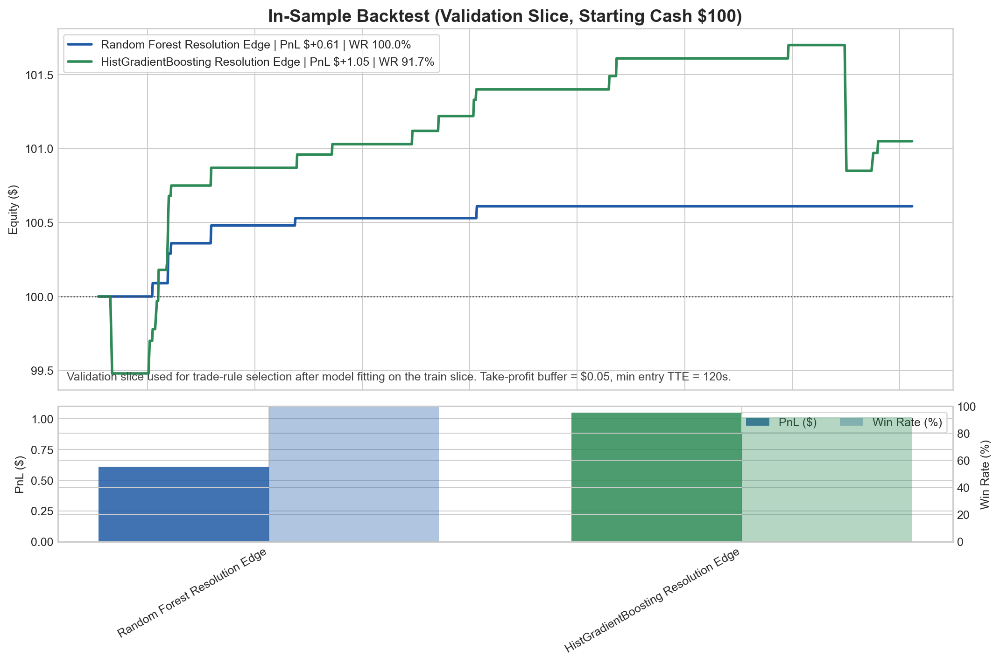
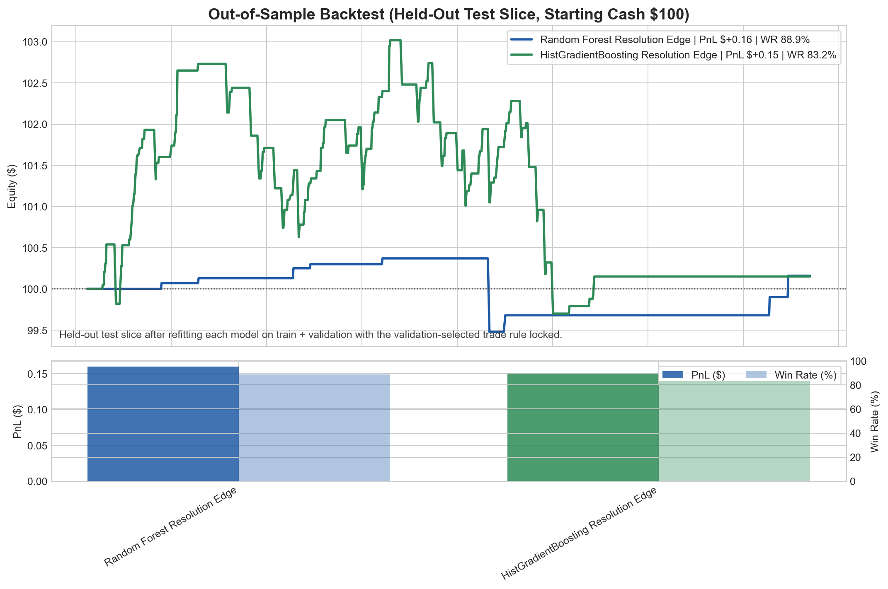

# kalshi_trade

Kalshi BTC 15-minute pipeline for ingestion, feature engineering, simulation, live trading controls, and observability.

## Setup

```bash
pip install -r requirements.txt
python -m data_pipeline.init_schema
```

## Architecture

### Active architecture (target-aligned)

```text
[Connectors]
  Kalshi REST/WS, Coinbase
      |
      v
[Ingestion Workers]
  forward_collector
  feature_1m_collector
  coinbase_collector
      |
      v
[MySQL / RDS]
  raw + derived stores
      |
      +--> model_features_1m_builder
      |
      +--> simulated_trading_engine (frozen models)
      |       |
      |       +--> risk_engine (adapter; dummy or settings-backed)
      |       +--> execution_kernel (dummy passthrough)
      |
      +--> live_trading_engine
      |       |
      |       +--> risk_engine (adapter; dummy or settings-backed)
      |       +--> execution_kernel (dummy passthrough)
      |
      +--> sim_portfolio_20s_updater
      +--> live_portfolio_20s_updater
      +--> dashboard_server (CloudFront)
              \--> /api/table for client_api (pandas)
```

### Key separation-of-concerns modules

- `data_pipeline/architecture/strategy.py`: strategy interface primitives.
- `data_pipeline/architecture/risk_engine.py`:
  - `LiveSettingsRiskEngine` (current policy adapter).
  - `DummyRiskEngine` (bypass mode).
- `data_pipeline/architecture/execution_kernel.py`:
  - `DummyExecutionKernel` (pass-through limit order submit; no execution optimization).
- `data_pipeline/live_trading_engine.py`: uses risk engine + execution kernel abstractions.

### Current behavior notes

- Data storage remains UTC.
- Dashboard renders timestamps in New York time (ET) for readability.
- Simulation uses **frozen models** (no per-minute retraining).

## Model Training & Backtest Methodology

### Current production label

- Base table: `model_features_1m` where `model_eligible=1`.
- Binary next-minute direction label:
  - `y_t = 1` if `mid_{t+1} > mid_t`, else `0`.
- Adjacent row pairs must share the same `market_ticker`.

### Train/Test split for simulation

- A live cutoff is read from `collector_state.sim_live_cutoff_utc`.
- Effective cutoff enforces a minimum in-sample span of 48 hours.
- Models are fit once on in-sample and then held fixed.
- Out-of-sample is cutoff to latest available row.

### Execution assumptions (simulation)

- Entry fill model: conservative quote-ask fill (`quote_ask_conservative`).
- Exit pricing:
  - same ticker: sell against available YES bid ladder only (no midpoint fallback).
  - ticker rotation: stale ticker bid ladder as-of replay timestamp (no lookahead).
  - if bid liquidity is insufficient for full size, consume next bid levels when available.
  - if no bid liquidity is available, remaining quantity is valued/exited at `0.00`.
  - near expiry (`time_to_expiry_sec <= 60`): force close at `0.99`.

### PnL

- Trade PnL: `(exit - entry) * qty`.
- `sim_equity_1m` includes realized cumulative PnL and mark-to-market context in `raw_json`.
- `sim_portfolio_20s` tracks cash, position value, equity, and drawdown over time.

## Models (Current)

Shared feature vector used by production models:

```text
x_t = [
  yes_bid_dollars,
  yes_ask_dollars,
  spread_dollars,
  mid_dollars,
  orderbook_imbalance,
  mid_ret_1m,
  mid_ret_3m,
  trades_last_60s_count,
  trades_last_60s_volume_fp,
  trades_last_60s_vwap_yes,
  quote_change_events_60s,
  time_to_expiry_sec,
  cb_ret_1m,
  cb_ret_3m,
  cb_ret_5m,
  cb_vol_5m,
  moneyness_abs,
  moneyness_pct,
  moneyness_vol_scaled,
  moneyness_x_sqrt_tte,
  moneyness_x_imbalance,
  moneyness_x_qchg
]
```

Current live/sim trade trigger rule:

- Predict `p_yes = P(Y=1 | x_t)`.
- Compute `edge = p_yes - yes_ask_dollars`.
- Trigger BUY YES only if:
  - `p_yes >= signal_threshold`
  - `edge > edge_threshold`

Configured thresholds in code/settings:

- `signal_threshold = 0.55`
- `edge_threshold = 0.01`

### 1) `naive_logistic_baseline` (baseline definition)

- Purpose: anchor for model-comparison discipline.
- Form: plain logistic regression:
  - `p_yes = sigmoid(w^T x_t + b)`
  - baseline feature subset:
    - `yes_bid_dollars`
    - `yes_ask_dollars`
    - `spread_dollars`
    - `mid_dollars`
    - `orderbook_imbalance`
    - `mid_ret_1m`
    - `mid_ret_3m`
    - `trades_last_60s_count`
    - `quote_change_events_60s`
    - `time_to_expiry_sec`
    - `cb_ret_1m`
    - `cb_ret_3m`
    - `moneyness_pct`
- Use: benchmark expected for in-sample/out-of-sample comparison.
- Note: baseline is included in simulation/dashboard comparisons.

### 2) `logistic`

- Regularized logistic regression (scaled features, balanced class weights).
- Prediction form:
  - `p_yes = sigmoid(w^T x_t + b)` using full `x_t` above.
- Trade trigger:
  - simulation: `signal_threshold=0.55`, `edge_threshold=0.01`
  - live: `signal_threshold` and `edge_threshold` loaded from `live_settings` (default same values).
- Frozen in simulation after in-sample fit.

### 3) `random_forest`

- Random Forest classifier with two parameter regimes:
  - small-sample regime.
  - default regime once `min_samples_default_rf` threshold is met.
- Prediction form:
  - `p_yes = RF(x_t)` where `x_t` is the full feature vector above.
- Trade trigger:
  - simulation: `signal_threshold=0.55`, `edge_threshold=0.01`
  - live: `signal_threshold` and `edge_threshold` loaded from `live_settings` (default same values).
- Frozen in simulation after in-sample fit.
- Used for live trading decisions.

## Expiry-Resolution Research (March 2026)

This repo now also contains a separate research path under `work/` for **multi-minute models built from `model_features_1m` via `client_api.KalshiDataClient`**.
These models are **not** in the live trading loop yet. They are research candidates only.

### 1) Y-label definition

The new research does **not** use the production next-minute label.
Instead, it uses an **expiry-resolution label** that is more consistent with holding a 15-minute contract for longer than one minute.

- Training rows come from `model_features_1m` with:
  - `model_eligible = 1`
  - non-null `yes_ask_dollars`
  - `time_to_expiry_sec >= 120`
- Rows are grouped by `market_ticker`.
- For each row `t`, define:
  - `y_t = 1` if the contract finishes in a YES-like terminal state, proxied by the ticker's **final observed YES bid >= 0.90**
  - `y_t = 0` otherwise

Why this label:

- The contract is a binary event contract, so a multi-minute trader really cares about **terminal resolution direction**, not whether the midpoint blips up over the next minute.
- `model_features_1m` does not currently store an explicit settlement flag, so the final YES bid is used as the best available proxy.

The same dataset also precomputes a simple executable trade path for backtesting:

- Entry price = current `yes_ask_dollars`
- Exit price = first future YES bid that reaches `entry + $0.05`
- If that take-profit is never hit, exit at the ticker's final observed YES bid

### 2) Models used

Three models are evaluated in the research runner:

- `logistic_resolution_edge`
  - benchmark only
  - compact linear model for calibration/reference, not the candidate we intend to deploy
- `random_forest_resolution_edge`
  - main non-linear tree candidate
  - designed to capture strike/time/microstructure interactions without requiring feature scaling
- `hist_gradient_boosting_resolution_edge`
  - boosting candidate
  - designed as the more flexible high-capacity tree baseline

The selected research candidates are the two tree models:

- `random_forest_resolution_edge`
- `hist_gradient_boosting_resolution_edge`

The benchmark is kept to answer a hard question: **are the tree models actually adding value beyond a simpler linear odds model?**

### 3) Hyperparameters, features, and why they are included

#### Logistic benchmark

- Model: `LogisticRegression`
- Setup:
  - `class_weight="balanced"`
  - `C=0.5`
  - standardized inputs via `StandardScaler`

Reason:

- This is the cleanest reference model.
- If the trees cannot beat this benchmark on ranking quality or tradable PnL, there is no case for added complexity.

Features used:

- quote state: `yes_bid_dollars`, `yes_ask_dollars`, `spread_dollars`, `mid_dollars`
- microstructure: `orderbook_imbalance`
- short-horizon momentum: `mid_ret_1m`, `mid_ret_3m`, `cb_ret_1m`, `cb_ret_3m`, `cb_ret_5m`
- activity/liquidity: `trades_last_60s_count`, `trades_last_60s_volume_fp`, `trades_last_60s_vwap_yes`, `quote_change_events_60s`
- horizon context: `time_to_expiry_sec`
- strike context: `moneyness_abs`, `moneyness_pct`, `moneyness_vol_scaled`, `moneyness_x_sqrt_tte`, `moneyness_x_imbalance`, `moneyness_x_qchg`

#### Random forest candidate

- Model: `RandomForestClassifier`
- Setup:
  - `n_estimators=500`
  - `max_depth=10`
  - `min_samples_leaf=4`
  - `min_samples_split=12`
  - `max_features="sqrt"`
  - `class_weight="balanced_subsample"`

Reason:

- The expiry-resolution problem is non-linear.
- Whether a contract should mean-revert or trend into expiry depends on joint interactions between:
  - current price vs strike,
  - remaining time,
  - order-book pressure,
  - recent Coinbase drift,
  - and current liquidity.
- A random forest is a robust first tree model for a small, noisy sample.

#### HistGradientBoosting candidate

- Model: `HistGradientBoostingClassifier`
- Setup:
  - `learning_rate=0.03`
  - `max_depth=4`
  - `max_iter=250`
  - `min_samples_leaf=25`
  - `l2_regularization=0.01`
  - `max_leaf_nodes=63`

Reason:

- This is the boosting candidate requested for the research extension.
- It is smoother than the forest and can fit interaction structure more aggressively, while the shallow depth and regularization keep the model from exploding on a short sample.

#### Tree-model feature expansion and rationale

The tree candidates use the linear benchmark features plus additional state variables:

- depth and pressure:
  - `yes_bid_size_fp`
  - `yes_ask_size_fp`
  - `depth_total`
  - `depth_pressure`
- execution/flow context:
  - `vwap_mid_gap`
  - `volume_per_trade`
  - `quote_intensity`
  - `microprice_proxy`
- nonlinear return interactions:
  - `return_accel_1v3`
  - `cb_return_accel_1v5`
  - `ret_cross_cb`
  - `spread_x_imbalance`
- strike carry context:
  - `cb_price`
  - `target_btc_price`
  - `carry_to_target`
  - `kalshi_data_age_sec`
  - `coinbase_data_age_sec`

Why these are reasonable:

- binary BTC buckets are driven by **distance to strike + time left**
- fills depend on **current quote state and size imbalance**
- short-term conviction depends on **spot drift, quote momentum, and trade pressure**
- stale data can create fake edge, so feed age is explicitly included

### 4) Backtesting mechanism

The research backtest is intentionally simple and explicit.

Chronological split:

- train = first 60%
- validation = next 20%
- test = final 20%

Interpretation:

- the **validation slice is the in-sample/model-selection period**
- the **test slice is the true out-of-sample period**
- frozen in-sample window used in the presentation artifacts: `2026-03-09 22:38:00` to `2026-03-10 21:21:00` UTC
- frozen out-of-sample window used in the presentation artifacts: `2026-03-10 21:22:00` to `2026-03-11 20:06:00` UTC

Signal generation:

- predict `p_yes = P(contract resolves YES | x_t)`
- compute `edge = p_yes - yes_ask_dollars`
- buy signal:
  - the research backtest is **long-only**
  - buy one new YES position only if no position is already open, `p_yes >= probability_threshold`, and `edge >= edge_threshold`
  - on the frozen run used in the README/presentation:
    - `Random Forest Resolution Edge` buys when `p_yes >= 0.65` and `p_yes - yes_ask_dollars >= 0.08`
    - `HistGradientBoosting Resolution Edge` buys when `p_yes >= 0.55` and `p_yes - yes_ask_dollars >= 0.08`

Trade management:

- only one position is open at a time
- there is **no model-driven short signal** and no discretionary sell signal after entry
- sell/exit signal:
  - once entered, the backtest exits at the first future YES bid that reaches `entry ask + $0.05`
  - if that take-profit is never hit, it exits at the final observed YES bid for that ticker
- exits are timestamp-based, not row-offset based, so the backtest does not accidentally close trades early due to filtered rows
- if the exit timestamp would occur outside the evaluated slice, that trade is skipped

Position sizing / units:

- position size is fixed at **1 YES contract per entry signal**
- PnL is therefore computed in normalized per-contract dollars: `trade_pnl = exit_bid - entry_ask`
- the `$100` starting cash shown in the presentation PNGs is only a visualization baseline: plotted equity = `100 + cumulative per-contract PnL`
- the current research intentionally does **not** size up by confidence, available cash, or order-book depth yet
- that was deliberate: it isolates signal quality first, so model comparison is not distorted by an ad hoc sizing rule

Parameter selection:

- model hyperparameters are fixed in code
- trade rules are tuned only on validation using:
  - `probability_threshold in {0.55, 0.60, ..., 0.90}`
  - `edge_threshold in {0.00, 0.01, 0.02, 0.03, 0.05, 0.08, 0.10, 0.12, 0.15, 0.20}`
- after the validation rule is chosen, the model is refit on `train + validation` and tested on the held-out test slice with the rule locked

### 5) Performance, interpretation, and what it implies

Frozen documentation snapshot from `work/expiry_resolution_results.json`:

- command used: `python work/run_horizon_model_research.py --end '2026-03-11 20:07:00'`

- dataset rows: `5909`
- date range: `2026-03-07 02:11:00` to `2026-03-11 20:06:00` UTC
- positive-rate for the expiry-resolution label: `0.4793`

Held-out results:

- `Logistic Resolution Edge` (benchmark)
  - AP `0.8540`, AUC `0.8501`
  - test PnL `+0.11`
  - trades `1`
  - interpretation: slight positive result, but far too sparse to support deployment conclusions
- `Random Forest Resolution Edge`
  - AP `0.8483`, AUC `0.8468`
  - test PnL `+0.16`
  - trades `9`
  - win rate `0.8889`
  - interpretation: this is the strongest of the two new models because it stays selective, remains slightly profitable on the frozen out-of-sample slice, and keeps the best balance between ranking quality and trade density
- `HistGradientBoosting Resolution Edge`
  - AP `0.8137`, AUC `0.8095`
  - test PnL `+0.15`
  - trades `131`
  - win rate `0.8321`
  - interpretation: the model is now slightly positive on the frozen test slice, but the average PnL per trade is only about `0.0011`, so the edge is too thin to trust without a better execution model and much more data

What this implies:

- there is likely **real directional information** in `model_features_1m`
- the new label is materially better aligned with a multi-minute hold than the old next-minute label
- the frozen out-of-sample slice is now mildly positive for both tree candidates, but the realized edge is still too small to call production-ready
- the random forest is the more credible near-term candidate
- the boosting model is still worth keeping because it gives a second non-linear view of the same feature set, but its edge is too thin after turnover to justify deployment
- the next step should be better label quality and execution realism, not immediate live promotion

Presentation artifacts generated from the same corrected backtest logic:

- in-sample plot = validation slice from `2026-03-09 22:38:00` to `2026-03-10 21:21:00` UTC
- out-of-sample plot = test slice from `2026-03-10 21:22:00` to `2026-03-11 20:06:00` UTC
- both PNGs start from `$100` cash and show only the two tree-model research candidates; the logistic benchmark is omitted from the chart to keep the comparison focused





Artifacts and rerun commands:

- research report: `work/expiry_resolution_report.md`
- research results JSON: `work/expiry_resolution_results.json`
- presentation charts: `presentation/in_sample_backtest.png`, `presentation/out_of_sample_backtest.png`
- regenerate research results:
  - `python work/run_horizon_model_research.py --end '2026-03-11 20:07:00'`
- regenerate presentation charts:
  - `python presentation/generate_backtest_graphs.py --end '2026-03-11 20:07:00'`

## Feature Set Used by Models

Full model feature set from `data_pipeline/modeling_features.py` (`FEATURE_COLS`):

- `yes_bid_dollars`
- `yes_ask_dollars`
- `spread_dollars`
- `mid_dollars`
- `orderbook_imbalance`
- `mid_ret_1m`
- `mid_ret_3m`
- `trades_last_60s_count`
- `trades_last_60s_volume_fp`
- `trades_last_60s_vwap_yes`
- `quote_change_events_60s`
- `time_to_expiry_sec`
- `cb_ret_1m`
- `cb_ret_3m`
- `cb_ret_5m`
- `cb_vol_5m`
- `moneyness_abs`
- `moneyness_pct`
- `moneyness_vol_scaled`
- `moneyness_x_sqrt_tte`
- `moneyness_x_imbalance`
- `moneyness_x_qchg`

Input source columns include `target_btc_price` and `cb_price` for moneyness construction.

Derived/interaction feature formulas:

- `spread_dollars = yes_ask_dollars - yes_bid_dollars`
- `mid_dollars = (yes_ask_dollars + yes_bid_dollars) / 2`
- `orderbook_imbalance = (yes_bid_size_fp - yes_ask_size_fp) / (yes_bid_size_fp + yes_ask_size_fp)` (if denominator > 0, else 0)
- `mid_ret_1m = (mid_t / mid_{t-1m}) - 1`
- `mid_ret_3m = (mid_t / mid_{t-3m}) - 1`
- `cb_ret_1m = (cb_t / cb_{t-1m}) - 1`
- `cb_ret_3m = (cb_t / cb_{t-3m}) - 1`
- `cb_ret_5m = (cb_t / cb_{t-5m}) - 1`
- `moneyness_abs = cb_price - target_btc_price`
- `moneyness_pct = (cb_price - target_btc_price) / target_btc_price`
- `moneyness_vol_scaled = moneyness_abs / max(cb_price * max(cb_vol_5m, 1e-6), 1e-6)`
- `moneyness_x_sqrt_tte = moneyness_pct * sqrt(max(time_to_expiry_sec, 1.0))`
- `moneyness_x_imbalance = moneyness_pct * orderbook_imbalance`
- `moneyness_x_qchg = moneyness_pct * quote_change_events_60s`

## Core Tables

- `forward_quotes`: 20-second top-of-book snapshots for active contract context.
- `coinbase_ticks`: 20-second BTC spot context.
- `trade_quote_features_1m`: minute trade intensity and quote-change aggregates.
- `model_features_1m`: canonical minute feature table for ML.
- `sim_model_predictions_1m`: model probabilities/signals per minute.
- `sim_trades`, `sim_positions`, `sim_equity_1m`, `sim_portfolio_20s`: simulation ledger and equity state.
- `live_orders`, `live_positions`, `live_trades`, `live_portfolio_20s`: live execution and portfolio tracking.
- `collector_state`: runtime checkpoints/config keys (`sim_live_cutoff_utc`, last snapshot states, etc.).

## Runtime Processes

Typical workers on EC2:

- `python -m data_pipeline.forward_collector`
- `python -m data_pipeline.feature_1m_collector`
- `python -m data_pipeline.coinbase_collector`
- `python -m data_pipeline.model_features_1m_builder`
- `python -m data_pipeline.simulated_trading_engine`
- `python -m data_pipeline.sim_portfolio_20s_updater`
- `python -m data_pipeline.live_trading_engine`
- `python -m data_pipeline.live_portfolio_20s_updater`
- `python -m data_pipeline.dashboard_server`

Helper script:

```bash
bash scripts/start_aws_collectors.sh
```

## Client API (Pandas)

`client_api` exposes full-history DataFrame fetch helpers (internal pagination hidden).

```python
from client_api import KalshiDataClient

client = KalshiDataClient(base_url="https://dehiuraiut9ro.cloudfront.net")
df_features = client.model_features()
df_preds = client.sim_predictions()
```

Notebook examples: `client_api/example.ipynb`.

## Security / Ops Notes

- Keep API keys and private key files out of git.
- Use `.env.aws` / environment variables for DB + API credentials.
- Live tab has an additional password gate.
