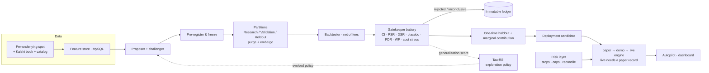

# Tau — RSI for Trading

**A recursively self-improving (RSI) research-to-live pipeline for trading.** An
agent proposes trading hypotheses, validates each in a backtest it cannot cheat
(it never sees the out-of-sample window while iterating), deploys only strategies
that pass the gates — and its *exploration policy recursively self-improves* from
its own accumulated discovery history (Tau-RSI, adapted from Dream-RSI). Built
on **Kalshi** prediction markets across a **wide tradeable universe** — crypto
(BTC/ETH/SOL/XRP/DOGE/NEAR/ZEC/HYPE), sports moneylines (NFL/NHL/NBA/NCAAF/MLB/EPL),
and weather — with a **catalog-driven generator** that makes any suitable
outcome-settled Kalshi series deployable. The data, backtest, and execution
layers are **venue-agnostic by design** (prediction markets, and other venues
over time). Deploy on paper, a real-fills demo sandbox, or to live money in your
own venue account.

**Status (2026-10-24):** the full pipeline runs in production at https://tau-trading.com, but no
strategy has cleared the research gates yet, so no real money is trading. The first paper
strategies run under an opt-in paper probation. See
[kalshi_trade_infra/README.md](kalshi_trade_infra/README.md) for how the system runs today.

> **Source-available, not (yet) open source.** Licensed under the Business
> Source License 1.1 — free for non-production use (evaluation, research,
> personal use); it converts to Apache-2.0 on the Change Date. See
> [LICENSE](LICENSE) and [NOTICE](NOTICE).

---

## What it is

- **Collectors** — per-underlying spot (Coinbase) + the Kalshi order book and trade
  prints → a MySQL feature store, plus a `kalshi_series` catalog that drives which
  markets are deployable. Only sports, weather and crypto are collected. Bitcoin is
  also recorded per tick (every book delta, trade and Coinbase print) into S3 Parquet.
- **Feature builder** — per-minute and per-second features (moneyness, realized vol,
  order flow, weather forecasts, …).
- **Research agent** — an LLM proposes parameterized strategy *specs* (never raw
  code); a challenger vets each, the spec is pre-registered and frozen, then a
  deterministic backtester (net of fees) scores it and a statistical gatekeeper
  gates it on **unseen** data. Every hypothesis — passed, rejected, or
  inconclusive — is recorded to an immutable ledger so the trial count stays
  honest. Agents can also write real **code strategies** in a sandbox carrying the
  full ML/quant stack (pandas, scipy, scikit-learn, statsmodels, xgboost, torch, …).
- **Simulated + live engines** — share one risk/execution abstraction, so a
  backtest and a deployment evaluate the identical rule. Paper orders run through
  the live execution kernel against a simulated venue, so paper fills are realistic. Execution is
  **crash-recoverable and exactly-once** (a durable order-intent log with a reused
  client-order-id), legging-safe for cross-market pairs, and runs through a
  marketable-limit kernel with thin-book controls. YES / NO / either-side and
  cross-contract strategies can all trade. Paper is the default; a real-fills demo
  sandbox sits between; live orders fire only when explicitly enabled, in your own
  Kalshi account.
- **Risk layer** — per-position and capital drawdown stops, auto-flatten on
  pause/stop, per-user open-notional / open-position caps, a daily-loss kill switch,
  a guard that refuses any sell that would take the account past flat, and continuous
  reconciliation of the live book against the exchange (a mismatch halts new entries).
- **Autopilot (co-pilot agent)** — can run the full research pipeline on its own
  and manage the operation within hard safety bounds: tune model, risk, and
  execution parameters (every value clamped — a stop can't be disabled, a cap
  can't be exceeded) and promote proven strategies to paper/live within your caps
  and a daily-loss kill switch. It never flips the live gate.
- **Dashboard / app** — monitor strategies, review each one as a rigorous research
  paper (thesis, pre-registration, the full stats battery, in- vs out-of-sample,
  holdout), and promote sim → live.
- **Tau-RSI** — a self-evolving research loop adapted from **Dream-RSI** (see
  [NOTICE](NOTICE)): the agent's exploration policy is re-scored on out-of-sample
  generalization and rewritten from its own discovery history, then fed back to
  the proposer so each batch explores smarter. On top of it, a scoreboard tracks why
  ideas die, per-family playbooks are rewritten after every run and A/B-tested on
  how often their ideas reach the gate, and ideas killed by missing data trigger
  collection of that data and a re-test.

## Pass criteria (how a strategy earns "passed")

The history is partitioned **Research 60% / Validation 25% / locked Holdout 15%**,
with a purge + embargo gap at every cut so no trade straddles a boundary. The
agent only ever iterates on Research. A finalist must clear a full statistical
battery on Validation — **bootstrap confidence intervals, PSR, DSR deflated by the
true trial count, a market-implied placebo test, a LORD++ FDR budget, purged
walk-forward, Benjamini–Hochberg, and a +1c cost stress** — all net of fees, with
backtest fills at the next bar and capped at the size on the book. Only then is the
**locked holdout spent once**, followed by a **marginal-contribution** check (low
correlation to what you already run). "No reliable edge" is a first-class, logged
outcome.

Passing research earns paper, not money. Going live needs a paper record on realistic
fills: 30+ round trips, net positive after fees, spread over 48h+, and a bootstrap
p ≤ 0.10, plus the server's live switch, the user's own opt-in, a connected Kalshi
key, and today's loss inside the daily limit.

## Architecture



## Setup

Requires Python 3.12+ (CI runs 3.12, production runs 3.13). Everything runs from
`kalshi_trade_infra/`.

```bash
cd kalshi_trade_infra
python -m venv .venv && source .venv/bin/activate
pip install -r requirements.txt

# configure: copy the example env and fill in DB creds, Kalshi key material, etc.
cp .env.example .env            # every variable's purpose is described inline

# create the full schema (pipeline tables + app migrations)
python -m app.schema

# run the tests (no live DB required — a FakeCursor fixture backs the suite)
python -m pytest tests/
```

Running the app locally, production layout and deploys:
[kalshi_trade_infra/README.md](kalshi_trade_infra/README.md).

## Disclaimer

Research/educational software. **Not investment advice.** Trading binary options
risks real capital; live orders fire only when you explicitly enable live mode
and connect your own Kalshi account. No warranty — see the LICENSE.

## License & attribution

Business Source License 1.1 (© 2026 Jihui Tan). The self-evolving research
component adapts **Dream-RSI** (arXiv:2609.14858). Full attributions in
[NOTICE](NOTICE).
