# kalshi_trade_infra

Everything that runs Tau, an automated research-to-live trading system on Kalshi prediction
markets: the data collectors, the research agent and its statistical gates, the paper and live
engines, the autopilot, and the web app at https://tau-trading.com.

Status as of 2026-10-24: no strategy has cleared the research gates yet, so nothing trades live.
The first paper strategies run under the opt-in paper probation (below). Real-money trading is off
unless the owner turns it on. Newest decisions and incident notes are at the top of
[`PLAN.md`](PLAN.md).

## Layout

| Path | What it is |
|---|---|
| `app/` | Tau: web server and SPA, research agent, backtester, gatekeeper, paper/live engine, autopilot, RSI loop |
| `data_pipeline/` | Collectors (Kalshi books, trades, catalog, Coinbase spot, ticks), feature builders, alerter, watchdog, the legacy BTC 15m sim/live engines |
| `data_pipeline/architecture/` | Shared execution pieces: `execution_kernel`, `risk_engine`, `position_guard`, `simulated_venue` |
| `scripts/` | Deploys (`deploy_web.sh`, `deploy_collector.sh`), systemd units, one-off ops tools |
| `tests/` | pytest suite (a `FakeCursor` fixture, no live DB needed) |
| `staging/` | Isolated Docker paper-trading staging stack |
| `client_api/` | pandas client for the legacy dashboard's `/api/table` |
| `results/` | Per-workstream `HANDOFF.md` evidence folders |

## How a strategy gets to money

1. **Research.** A user (or the autopilot) names a market and an idea. The proposer writes
   concrete strategy specs or sandboxed code strategies, a challenger vets them, and each is
   pre-registered and frozen before any held-out data is read.
2. **Gates.** The backtester replays the spec net of Kalshi fees, filling at the next bar
   (`TAU_BACKTEST_FILL_MODEL=next_bar`; `tick` replays per-second data). The gatekeeper alone reads
   Validation and the locked Holdout. See [Research gates](#research-gates).
3. **Paper.** The autopilot puts each `DEPLOYMENT_CANDIDATE` on paper (users can also deploy
   any strategy to paper or to Kalshi's demo sandbox by hand). Paper orders go through the live
   execution kernel against `SimulatedVenue`, so fills are realistic (`order_ref` starts `sim:`).
   With `APP_PAPER_PROBATION=1`, up to 4 validation near misses (net > 0, p ≤ 0.25, ≥ 20 trades)
   also run on paper, never live.
4. **Live.** Only a `DEPLOYMENT_CANDIDATE` whose `agent.paper_evidence` passes: 8+ closed paper
   trades and not down, then on realistic fills 30+ round trips, net > 0 after fees, a 48h+
   span, a stationary-bootstrap p ≤ 0.10, the newer half up, and last a clean demo record
   (`services.demo_record`: 20+ settled demo orders, none lost, and the demo book matching the demo
   exchange on the 15-minute sweeps). Autopilot live also needs `agent.live_autopilot_ok`: the user's autopilot and
   `autopilot_live` switches, `APP_LIVE_TRADING_ENABLED=1` on the server, a connected Kalshi key,
   and today's live loss inside `autopilot_daily_loss_limit`. A manual live deploy needs the
   server switch, a key and a typed `LIVE` confirmation; NO-side live also needs
   `APP_NO_SIDE_LIVE_ENABLED=1`.

## Research gates

History is split Research 60% / Validation 25% / locked Holdout 15% (`app/partitions.py`), with
purge and embargo at each cut. The generator only ever iterates on Research.

```mermaid
flowchart LR
    Idea(["Your hypothesis,<br/>in one sentence"])

    subgraph GEN["Generator: blind to Validation &amp; Holdout numbers"]
        direction LR
        Proposer["Proposer<br/>writes concrete,<br/>testable strategy specs"]
        Challenger["Challenger<br/>approve / revise / reject<br/>each spec"]
        Freeze["Pre-register &amp; freeze<br/>spec, metric &amp; test hashed<br/>before any held-out data is seen"]
        Proposer --> Challenger --> Freeze
    end

    subgraph DATA["Partitioned history: purge + embargo at every cut"]
        direction LR
        Research["Research 60%<br/>the only data the<br/>generator iterates on"]
        Validation["Validation 25%"]
        Holdout["Locked holdout 15%<br/>spent once"]
    end

    subgraph GATE["Statistical gatekeeper: the only reader of Validation &amp; Holdout"]
        direction TB
        Backtest["Net-of-fee backtest<br/>next-bar fills, capped at book size"]
        Battery["Test battery on Validation<br/>bootstrap CI · PSR ·<br/>DSR deflated by trial count ·<br/>market-implied placebo · LORD++ FDR ·<br/>Benjamini–Hochberg ·<br/>purged walk-forward · +1c cost stress"]
        Backtest --> Battery
    end

    Verdict{"Clears ALL<br/>tests at once?"}
    Ledger[("Immutable ledger<br/>rejected &amp; inconclusive logged:<br/>trial count stays honest")]
    HoldoutEval["One-time holdout eval<br/>locked 15% spent once<br/>→ FORWARD_VALIDATED"]
    Marginal{"Marginal contribution<br/>|ρ| ≤ 0.80 vs live book?"}
    Candidate(["DEPLOYMENT_CANDIDATE"])

    Idea --> Proposer
    Freeze --> Research
    Research --> Backtest
    Validation -. "read by gatekeeper only" .-> Battery
    Battery --> Verdict
    Verdict -- "no · most ideas exit here" --> Ledger
    Verdict -- "yes · STAT_SUPPORTED" --> HoldoutEval
    Holdout -. "read by gatekeeper only" .-> HoldoutEval
    HoldoutEval --> Marginal
    Marginal -- "no" --> Ledger
    Marginal -- "yes" --> Candidate

    Verdict -. "RSI: scoreboard + per-family playbooks;<br/>labels only, never held-out numbers" .-> Proposer
```



Thresholds live at the top of `app/gatekeeper.py`: `ALPHA=0.10`, `DSR_MIN=0.5` (owner's choice;
`research_eval` keeps 0.95), `CORR_MAX=0.80`, `COST_STRESS_CENTS=1.0` (held-out trades re-run with
1c extra slippage must stay positive), and a power pre-screen that marks ideas `underpowered`
before spending validation. `tests/test_gate_power.py` checks that a planted 15c edge passes and
a fair market does not; run it before blaming "no edge exists". Full spec:
[`RESEARCH_PIPELINE_DESIGN.md`](RESEARCH_PIPELINE_DESIGN.md).

## The RSI loop

Research is meant to get better at finding edges from its own results:

- `app/rsi.py`: per-run scorecard and a scoreboard (funnel, spend, why ideas died). API
  `GET /api/research/scoreboard`, CLI `python -m app.rsi --days 7`.
- `app/rsi_playbook.py`: one playbook per (user, market family). After each run the model
  rewrites it into a candidate, and a Thompson draw A/B-tests candidate against incumbent on
  gate-reach rate. A promotion is held if the candidate's passes lose on paper.
- `app/rsi_scout.py`: free mispricing scan of the research window (`tau-scout.timer`).
- `app/rsi_repair.py`: a crypto idea that died for missing data files an `app_data_requests` row;
  the pipeline collects it and the idea is re-tested once.
- `app/dreaming.py`: the original exploration-policy evolution, still called by the agent.

## Markets and data

- **Markets** (`app/markets.py`): curated crypto (BTC/ETH/SOL/XRP/DOGE/NEAR/ZEC/HYPE 15-minute,
  BTC/ETH/SOL/XRP daily), sports moneylines (NFL/NHL/NBA/NCAAF/MLB/EPL), NYC high temperature,
  plus every recurring catalog series in Sports or Climate and Weather. `btc15m_tick` (per-second
  replay) and `btc_perp` are research only.
- **Scope rule** (2026-10-24): only sports, weather and crypto are collected or kept.
  `data_pipeline.common.TRADED_CATEGORIES` and `is_traded_series()` enforce it (MVE parlays are
  rejected too); `python -m scripts.prune_untraded_markets` prunes old rows (dry run by default).
- **Storage**: RDS MySQL 8.4 (`kalshi-trade-mysql`) holds markets, candles, features, trades,
  research and money tables. Per-tick Bitcoin data (every KXBTC* book delta, trade and ticker, and
  Coinbase BTC-USD prints) is recorded on the collector box and archived hourly to S3 Parquet under
  `ticks/v1/` in the datalake bucket; read it with `data_pipeline/tick_store.py`
  (`book_1s`, `trades_1s`, `spot_1s`, `features_1s`).
- **Side data**: weather forecasts (NBM and GFS MOS from IEM, `app/adapters/data/weather_fcst*.py`), Kalshi
  `/historical` candles back to 2021 for weather, measured execution costs
  (`python -m app.exec_cost_model`). The sportsbook odds collector exists but has no key, so it
  is a no-op.

## Safety layers

- **Live switch**: app users can place real orders only with `APP_LIVE_TRADING_ENABLED=1`. Native
  Bitcoin perps have their own switch, `TAU_KALSHI_PERPS_LIVE_ENABLED` (default 0, off in prod),
  and every perps ticket needs the user's confirmation. Turning either on is the owner's call.
- **Position guard** (`architecture/position_guard.py`): every real-order path wraps its submitter
  so a SELL is checked against Kalshi's position and can never open a short. New order paths
  must use `position_guarded_submitter`.
- **Reconciliation**: `app/reconcile.py` halts entries on a book mismatch, and the alerter
  (`data_pipeline/live_alerter.py`) reports mismatches that survive two passes.
- **Loss limits**: per-position stop (default 40%), drawdown limit (default 25%), the engine's
  loss guard (pause at max(2× backtest worst drawdown, 50% of capital)), an account-equity kill
  switch on `autopilot_daily_loss_limit`, and a live ramp and decay guard for new live strategies.
- **Exactly-once orders**: a durable `app_order_intents` log with a reused client order id, so a
  crash can't double-send.

## Production

Two EC2 boxes in us-east-1, both under systemd (units in [`scripts/systemd/`](scripts/systemd/README.md)).

| Box | Runs | Deploy |
|---|---|---|
| Web, `i-077d6f7873e7836ba` (t4g.xlarge), behind CloudFront `EEQ00Y93RTB1K` | `recursive-web`, `recursive-agents`, `recursive-engine`, `recursive-history`; timers for weather forecasts, the RSI scout, the alerter and the watchdog; the legacy `kalshi-dashboard` | `scripts/deploy_web.sh` or the **Deploy web app** workflow |
| Collector, `i-0bd0683cc7e86243d` (t4g.medium) | Forward, Coinbase and feature collectors, the feature builder, snapshots, the legacy sim engine, the tick recorders and archiver; `tau-catalog.timer` | `scripts/deploy_collector.sh` or the **Deploy collector box** workflow |

The legacy `kalshi-live-engine` on the collector box is stopped and disabled (2026-10-24); live
trading now goes through `recursive-engine`. The LLM runs through Bedrock
(`APP_LLM_PROVIDER=bedrock`); autopilot reviews use `APP_REVIEW_MODEL` (default Sonnet 4.5).

**Deploying the web box.** Merge to main, then run `scripts/deploy_web.sh` from a clean checkout
(`unset AWS_PROFILE` when using env credentials). It tars the whole `app/` and `data_pipeline/`
from the git ref, runs `python -m app.schema`, applies memory caps, restarts the four
`recursive-*` services, health-checks, rolls back on failure, and invalidates CloudFront `/*`.
Before restarting the engine, check that no `app_order_intents` row is stuck at `status='sent'`.
Only one deploy runs at a time; batched deploys go out once an hour.

**Deploying the collector box.** Run `scripts/deploy_collector.sh --ref main` from a checkout at
main: the bundle comes from `--ref`, but the install logic (which units to install) comes from
the local copy of the script.

## Local development

Python 3.12+ (CI runs 3.12, production runs 3.13). From this directory:

```bash
pip install -r requirements.txt
cp .env.example .env            # every variable is described inline
python -m app.schema            # full schema: pipeline tables + app migrations
python -m pytest tests/ -q      # no live DB needed
```

To run the app against a local MySQL or MariaDB, see "Run locally" in
[`app/README.md`](app/README.md#run-locally): start `app.server` with `APP_DEV_LOGIN=1
APP_INSECURE_COOKIES=1`, log in at `/auth/dev`, and run `python -m app.worker agents` and
`python -m app.worker engine` beside it.

## Other docs

- [`AGENTS.md`](AGENTS.md): rules for coding agents (deploy checklist, rigor bar, safety).
- [`PLAN.md`](PLAN.md): running log of decisions and incidents, newest first.
- [`RESEARCH_PIPELINE_DESIGN.md`](RESEARCH_PIPELINE_DESIGN.md), [`EXECUTION_DESIGN.md`](EXECUTION_DESIGN.md),
  [`PRODUCT.md`](PRODUCT.md), [`DESIGN.md`](DESIGN.md): design specs.
- [`app/README.md`](app/README.md): app internals and dated release notes.
- [`app/KALSHI_PERPS_TRADING.md`](app/KALSHI_PERPS_TRADING.md), [`app/KALSHI_PERPS_RESEARCH.md`](app/KALSHI_PERPS_RESEARCH.md): native Bitcoin perps.
- [`scripts/DEPLOY_WORKFLOW_SETUP.md`](scripts/DEPLOY_WORKFLOW_SETUP.md): GitHub deploy workflow setup.

## Legacy BTC 15-minute pipeline

The original system, still partly running on the collector box: `forward_collector` and
`coinbase_collector` feed `feature_1m_collector` and `model_features_1m_builder`, which build
`model_features_1m` (features in `data_pipeline/modeling_features.py`). `simulated_trading_engine`
runs frozen logistic and random-forest next-minute direction models, each with its own $100 paper
book and the risk settings in `data_pipeline/sim_config.py`. Its live twin,
`data_pipeline/live_trading_engine.py`, is retired. `dashboard_server` still serves the old
dashboard and `/api/table` on the web box; its old public CloudFront URL no longer resolves to a
live origin.

## Security

- Keep API keys, private keys and `.env*` files out of git.
- Kalshi keys in the app are AES-256-GCM encrypted with `APP_SECRET_KEY`, bound to the user id.
- Run a security review on any change that touches money, orders, auth or a control path.
