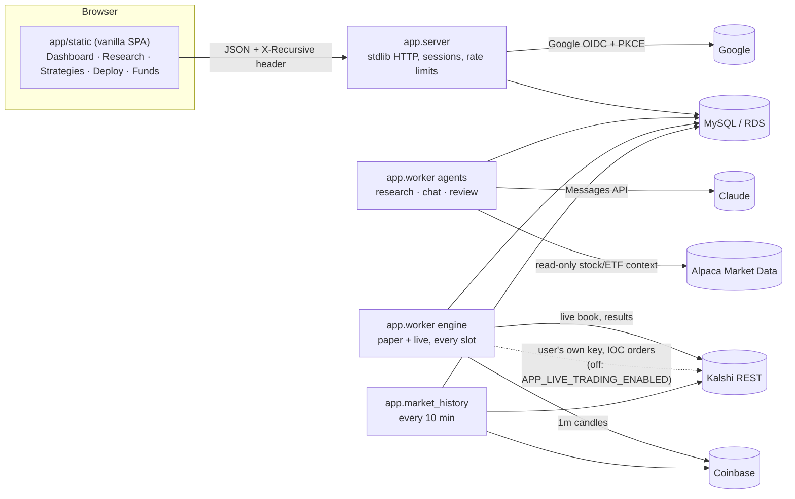
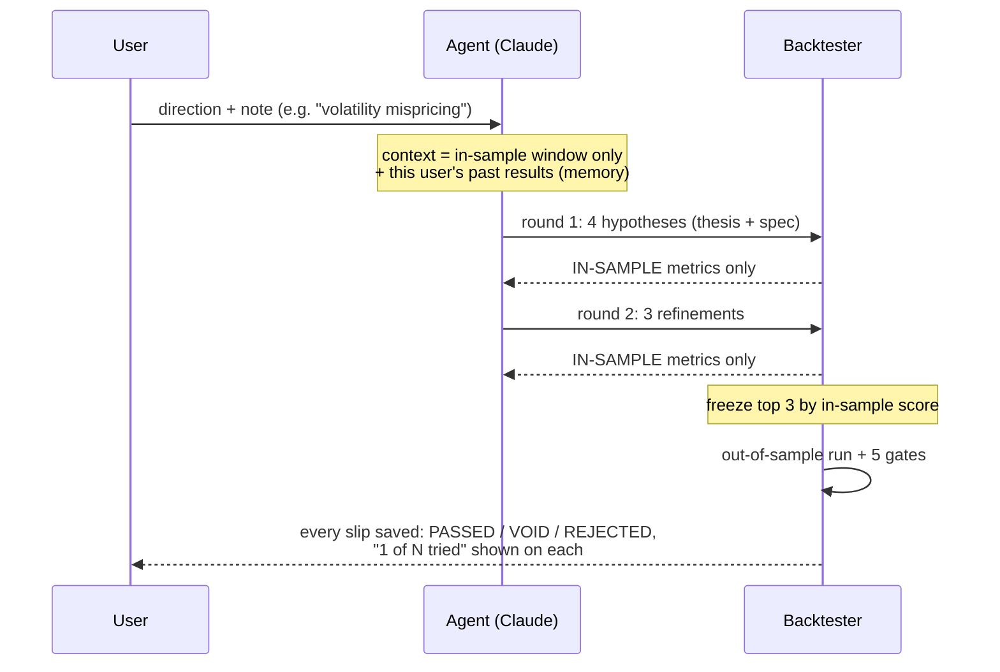

# Tau (v0.1)

The customer product: Google sign-in, agents that research Kalshi Bitcoin markets, a
backtest gate the agent cannot game, paper-first deployment, and a co-pilot chat.
Product truth is in `../PRODUCT.md`; the operator console (`data_pipeline/dashboard_server.py`)
is unchanged and separate.

## Alpaca stock/ETF data for agents — October 16, 2026

`app/alpaca_data.py` reads US stock/ETF snapshots and historical OHLCV bars from
Alpaca. `app/agent_market_data.py` connects those reads to the actual research and
copilot worker functions. No new dependency, database table or browser credential
is required. This is market-data context; the Kalshi strategy language, backtester
and order engine still evaluate Kalshi contracts. Equity strategy execution is a
separate integration.

Configure the **agent worker's server environment** using its existing env file or
secret manager. TAU does not automatically load the standalone Polygon `.env`.
Use the existing Alpaca key pair as `APCA_API_KEY_ID` and `APCA_API_SECRET_KEY`, then:

```bash
export TAU_ALPACA_ENABLED=1
export TAU_ALPACA_FEED=iex
export TAU_ALPACA_SYMBOLS=SPY,QQQ,IWM,TLT,GLD,USO
python -m app.alpaca_data status
python -m app.alpaca_data snapshots SPY AAPL
python -m app.alpaca_data bars SPY --start 2026-09-01 --end 2026-10-01 --timeframe 1Hour
python -m app.worker agents
```

`status` checks configuration only; `snapshots`/`bars` perform real read-only
requests. Enabling this feature never calls a brokerage/order endpoint.
`iex` is explicitly **IEX-only**, including its volume and quotes. Set `sip` only
with matching entitlement; a denied feed returns a visible error and is never
silently downgraded. Multi-user/commercial data rights remain an operator gate.

The agent receives the configured watchlist automatically. It can request other
symbols using its existing JSON response channel, for example:

```json
{"market_data_requests":[{"kind":"bars","symbols":["AAPL","MSFT"],"timeframe":"1Hour","lookback_days":7}]}
```

The host executes the reads and returns data before the next model response. A
current-time copilot may request `{"kind":"snapshots","symbols":["SPY"]}`.
Data requests are exclusive of actions/hypotheses; only the final validated task
response can propose existing actions. All model calls, including data-request
rounds, use the existing usage/billing path. Research cancellation is checked
before additional model/data operations.

- **Research:** raw, completed bars end at the existing training cutoff; lookback
  is also clamped to the training start. Current snapshots are denied. The data
  is supplementary context, not a new executable feature or proof that an equity
  strategy passed a backtest.
- **Copilot:** latest trades/quotes and bars carry provider, feed and timestamps.
  Snapshot freshness is recalculated even on cache hits; crossed/one-sided quotes
  are not usable current quotes. Prices older than 180 seconds are marked stale.
  Historical copilot reads end at least 20 minutes ago to accommodate Basic-plan
  history restrictions; snapshots supply current prices.
- **Bounds:** eight symbols/request, two requests/response, two data rounds/task
  response, 1–90 lookback days, five pages/10,000 raw bars per historical read.
  Bars support `1Min`, `5Min`, `15Min`, `1Hour`, `1Day`. Requests use fixed HTTPS
  data endpoints, three attempts, bounded timeouts/backoff and no redirects.
- **Evidence:** run events retain the data actually supplied to the agent.
  Historical context contains full-window statistics plus an explicitly labeled
  sample of the last 12 completed bars. Per-process caches retain current reads
  for 60 seconds and historical research reads for 300 seconds, isolated by feed,
  credentials and query window. A provider failure is reported as unavailable.
- **Limits:** no streaming collector, persistent equity warehouse, corporate-action
  tables, historical universe or equity broker/account integration is added.
  Raw vendor history can include later corrections; the cutoff prevents later
  intervals from entering the prompt but does not create a certified point-in-time
  dataset. Feed credentials stay in the server process and out of model context.

Verification on the clean PR branch: **258 Python tests passed, 7 opt-in MySQL tests skipped**. A separate
read-only local IEX check delivered a real SPY trade/quote snapshot and 44 hourly
bars to a scripted agent, with the historical sample before the cutoff. Production
worker activation and live-model acceptance remain pending. See the
[implementation status](../PLAN.md) for remaining gates.

## Architecture



Every process is stateless apart from MySQL, so each scales by running more copies:
agent runs are claimed with `SELECT … FOR UPDATE SKIP LOCKED`, engine decisions with a
per-deployment, per-slot claim (`claim_decision`), and every money write is idempotent.

## The research loop (why it's "recursive")



The agent never sees out-of-sample numbers or even the out-of-sample dates while it
iterates. Each run's results become memory for the next run on that market.

## The rule (one implementation, two callers)

`app/spec.py` is the only decision logic. The backtester and the live engine both call
`entries()` / `exit_signal()` on snapshots built by the same `markets.snapshot()`, so a
deployed strategy trades exactly what passed.

```
fair P(YES) = Phi( (ln(S/K) + mu*T) / (sigma*sqrt(T)) )
  sigma = vol_scale * realised 1m vol (15 or 60 min)
  mu    = drift_beta * BTC return over drift_window / drift_window
edge(YES) = P - yes_ask        edge(NO) = yes_bid - P
enter when edge >= min_edge, price/tte/spread in range, all filters hold
exit: take_profit / stop_loss / edge decay, else hold to settlement
```

| Market | Kalshi series | Decision cadence | History |
|---|---|---|---|
| `btc15m` | KXBTC15M | every minute | 30 days of 1m candles |
| `btc_daily` | KXBTCD, 5pm EDT event only | every hour | 60 days of 1h candles (strikes within ±7% of BTC at open) |

Fills: buy at the ask, sell at the bid, Kalshi taker fee (`kalshi_fees`) on every fill,
settle on Kalshi's own `result`. Paper fills are capped at the size shown on the book.

## Gates (all must pass to deploy)

| Gate | Threshold |
|---|---|
| Makes money in-sample | > $0 |
| Makes money on unseen data | > $0 |
| Enough unseen trades | ≥ 10 |
| Unseen profit factor | ≥ 1.1 |
| Unseen worst drawdown | ≤ 50% of capital |

Agent adjustments (chat or autopilot) are re-backtested against the same gates before they
can be proposed or applied.

## Guardrails

* Autopilot may: apply gate-passing adjustments that don't raise stake or position count,
  deploy passed strategies **on paper**, and pause anything. It may never move money to
  live or resume a live deployment.
* Loss guard (engine, no model involved): a deployment that loses more than
  max(2 × its backtest's worst unseen drawdown, 50% of capital) is paused, and a review run is queued.
* Live for app users is off unless `APP_LIVE_TRADING_ENABLED=1`; live is YES-only, needs a
  connected key and a typed `LIVE` confirmation.
* Kalshi private keys are AES-256-GCM encrypted (`APP_SECRET_KEY`), bound to the user id.
* Limits: 2 concurrent / 12 daily research runs, 40 chat messages per hour, 10 active deployments.

## Run locally

```bash
docker run -d --name recursive-mysql -e MYSQL_ROOT_PASSWORD=devroot -e MYSQL_DATABASE=kalshi_trade -p 3307:3306 mysql:8.0
export MYSQL_HOST=127.0.0.1 MYSQL_PORT=3307 MYSQL_USER=root MYSQL_PASSWORD=devroot
python -m app.schema
python -m app.market_history            # leave running; first backfill takes ~20 min
APP_DEV_LOGIN=1 APP_INSECURE_COOKIES=1 python -m app.server   # http://127.0.0.1:8090/auth/dev
ANTHROPIC_API_KEY=... python -m app.worker agents
python -m app.worker engine
APP_TEST_MYSQL=1 python -m pytest tests/   # includes the money-path tests against MySQL
```

## Production environment (`/opt/kalshi/.env.app`)

| Variable | Purpose |
|---|---|
| `GOOGLE_CLIENT_ID`, `GOOGLE_CLIENT_SECRET` | OAuth client (Web application) |
| `APP_GOOGLE_REDIRECT_URI` | e.g. `https://<host>/auth/google/callback`, registered in Google Cloud |
| `APP_SECRET_KEY` | 32 random bytes, urlsafe base64 (`python -c "import os,base64;print(base64.urlsafe_b64encode(os.urandom(32)).decode())"`) |
| `ANTHROPIC_API_KEY`, `APP_AGENT_MODEL` | agent model (default `claude-sonnet-5-5`) |
| `APP_LIVE_TRADING_ENABLED` | leave unset until explicitly authorised |

CloudFront in front of the app must forward cookies and allow POST (the existing
distribution forwards no cookies and was GET-only until 2026-09-26).
