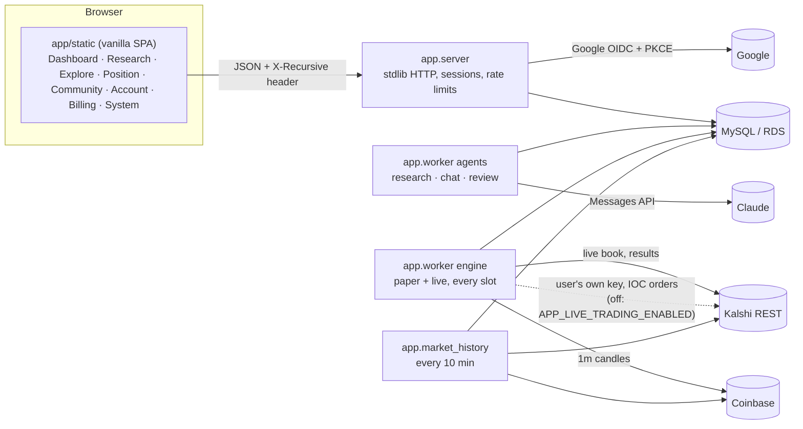
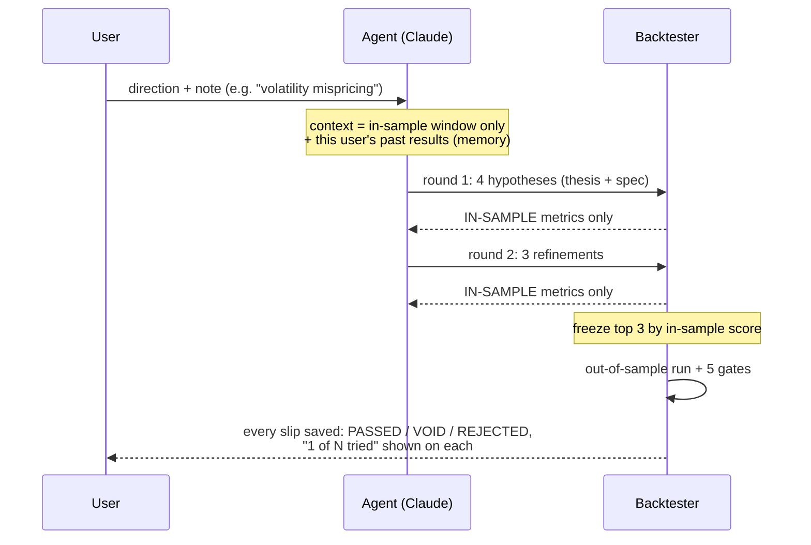

# Tau (v0.1)

The customer product: Google sign-in, agents that research Kalshi Bitcoin markets, a
backtest gate the agent cannot game, paper-first deployment, and a co-pilot chat.
Product truth is in `../PRODUCT.md`; the operator console (`data_pipeline/dashboard_server.py`)
is unchanged and separate.

## Architecture



Every process is stateless apart from MySQL, so each scales by running more copies:
agent runs are claimed with `SELECT … FOR UPDATE SKIP LOCKED`, engine decisions with a
per-deployment, per-slot claim (`claim_decision`), and every money write is idempotent.

## Research conversations and strategy artifacts

Research owns research sessions
and their generated strategies. `/research` retains the original idea/market form
and run history, with **Browse all strategies** for the existing library/filters.

`/research/{id}` shows a session conversation on the **left** and opened strategy
artifacts in tabs on the **right**. The conversation includes the original idea,
agent activity and every available candidate status, including void/rejected
results. Open, switch or close tabs; keyboard arrows/Home/End also select them.
At <=800px, Conversation/Strategies buttons switch panes; opening a strategy
selects its pane and closing the last tab returns to conversation.

Each artifact retains the full restored strategy sheet: P&L, trades, return,
capital/tries, thesis, rules, equity curve, sample/unseen metrics, dataset dates,
latest trades, exact spec, gates and what-if controls. Tabs keep independent
scenario/reading state, and late responses cannot replace a different selection.
Scenarios are labelled separately; deployment uses the original saved rule/verdict.
The shared paper/live deployment component is also available under **Ready to
deploy** in Position. Existing deployments, Pause/Stop, positions, account-wide
chat/autopilot, Account, Billing, Community and Admin/System remain.

There is no independent Strategies navigation item. Old `/strategies` links open
the filtered library under Research; `/strategies/{id}` resolves to its research
workspace and opens the artifact. Adjustments follow available ancestors;
standalone/missing-ancestor artifacts retain their own review workspace. Owner-
scoped backend reads remain. The upstream 50-run/500-strategy read windows and 50-row library pagination are retained;
older adjustment-history pagination is future work.

**UI plus backend connection contract:** `session-chat.js` uses only the proposed
session-scoped endpoints in [SESSION_CHAT_API.md](SESSION_CHAT_API.md). The backend
still lacks those routes; the real handler shows Not connected, retains drafts
and disables sends/actions. Session drafts/open tabs survive SPA navigation in
this page instance, are isolated by user/session and are cleared on sign-out.
A browser reload resets that temporary state. Position's existing `/api/chat`
remains account-wide and is never a session fallback. Revision backtest/comparison
and manual approval controls retain their existing capability gates.

Verification from `kalshi_trade_infra/`:

```bash
node --check app/static/app.js
node --test tests/test_app_sessions.mjs tests/test_session_chat.mjs tests/test_research_artifacts.mjs
APP_TEST_MYSQL=0 AWS_EC2_METADATA_DISABLED=true .venv/bin/python -m pytest tests/ -q
```

Rebased verification: 157 Python tests passed (7 opt-in MySQL skips), 29 Node tests passed, plus 24 browser and 14 HTTP checks.
Explore, Hot Markets, public System, research depth/run-forever/automatic market choice,
credit confirmations and upstream deployment warnings remain available. The obsolete
System page admin redirect is removed to match its public, owner-scoped backend API. The artifact
controls follow the current backend policy for passed/void/rejected saved candidates;
Position highlights passed candidates. Existing research-only market and live guards remain.

Current evidence: [workspace handoff](../results/frontend_pr_2026-10-15/HANDOFF.md).
Local editing preview data/replies are synthetic; actions are disabled. Verification
also uses actual GET handlers plus explicitly enabled synthetic send/scenario
fixtures; no database, model, payment or trading operation is performed.

## Approved copy/control cleanup (October 15, 2026)

C1–C11 and B1–B2 are applied to the Research workspace and Position. One session
status/count, compact grouped message targets and accessible composer labels
replace repeated headings/instructions. Artifact direction, strategy IDs/titles,
evidence, scenarios and financial gates remain. Position retains each strategy's
stake and distinct paper/live controls, with one platform-wide live notice and
strategy-specific restrictions when applicable. Duplicate workspace/empty-state
navigation is removed; existing sections/library filters remain.

The editing fixture is labelled **Sample conversation**, with one current revision
card and its proposal/backtest stages still in the chronological messages. Only
synthetic demo invitations/history links changed; real message records and
backend routes are untouched. The real scoped API remains unimplemented and shows
Not connected. Evidence: [cleanup handoff](../results/frontend_pr_2026-10-15/HANDOFF.md).

## The research loop (why it's "recursive")



The agent never sees out-of-sample numbers or even the out-of-sample dates while it
iterates. Each run's results become memory for the next run on that market.

## The rule (one implementation, two callers)

`app/spec.py` is the only decision logic. The backtester and the live engine both call
`entries()` / `exit_signal()` on snapshots built by the same `markets.snapshot()`, so a
deployed strategy trades exactly what passed.

```
fair P(YES) = Phi( (ln(S/K) + mu*T) / (sigma*sqrt(T)) )
  sigma = vol_scale * realised 1m vol (15 or 60 min)
  mu    = drift_beta * BTC return over drift_window / drift_window
edge(YES) = P - yes_ask        edge(NO) = yes_bid - P
enter when edge >= min_edge, price/tte/spread in range, all filters hold
exit: take_profit / stop_loss / edge decay, else hold to settlement
```

| Market | Kalshi series | Decision cadence | History |
|---|---|---|---|
| `btc15m` | KXBTC15M | every minute | 30 days of 1m candles |
| `btc_daily` | KXBTCD, 5pm EDT event only | every hour | 60 days of 1h candles (strikes within ±7% of BTC at open) |

Fills: buy at the ask, sell at the bid, Kalshi taker fee (`kalshi_fees`) on every fill,
settle on Kalshi's own `result`. Paper fills are capped at the size shown on the book.

## Gates (all must pass to deploy)

| Gate | Threshold |
|---|---|
| Makes money in-sample | > $0 |
| Makes money on unseen data | > $0 |
| Enough unseen trades | ≥ 10 |
| Unseen profit factor | ≥ 1.1 |
| Unseen worst drawdown | ≤ 50% of capital |

Agent adjustments (chat or autopilot) are re-backtested against the same gates before they
can be proposed or applied.

## Guardrails

* Autopilot may: apply gate-passing adjustments that don't raise stake or position count,
  deploy passed strategies **on paper**, and pause anything. It may never move money to
  live or resume a live deployment.
* Loss guard (engine, no model involved): a deployment that loses more than
  max(2 × its backtest's worst unseen drawdown, 50% of capital) is paused, and a review run is queued.
* Live for app users is off unless `APP_LIVE_TRADING_ENABLED=1`; live is YES-only, needs a
  connected key and a typed `LIVE` confirmation.
* Kalshi private keys are AES-256-GCM encrypted (`APP_SECRET_KEY`), bound to the user id.
* Limits: 2 concurrent / 12 daily research runs, 40 chat messages per hour, 10 active deployments.

## Run locally

```bash
docker run -d --name recursive-mysql -e MYSQL_ROOT_PASSWORD=devroot -e MYSQL_DATABASE=kalshi_trade -p 3307:3306 mysql:8.0
export MYSQL_HOST=127.0.0.1 MYSQL_PORT=3307 MYSQL_USER=root MYSQL_PASSWORD=devroot
python -m app.schema
python -m app.market_history            # leave running; first backfill takes ~20 min
APP_DEV_LOGIN=1 APP_INSECURE_COOKIES=1 python -m app.server   # http://127.0.0.1:8090/auth/dev
ANTHROPIC_API_KEY=... python -m app.worker agents
python -m app.worker engine
APP_TEST_MYSQL=1 python -m pytest tests/   # includes the money-path tests against MySQL
```

## Production environment (`/opt/kalshi/.env.app`)

| Variable | Purpose |
|---|---|
| `GOOGLE_CLIENT_ID`, `GOOGLE_CLIENT_SECRET` | OAuth client (Web application) |
| `APP_GOOGLE_REDIRECT_URI` | e.g. `https://<host>/auth/google/callback`, registered in Google Cloud |
| `APP_SECRET_KEY` | 32 random bytes, urlsafe base64 (`python -c "import os,base64;print(base64.urlsafe_b64encode(os.urandom(32)).decode())"`) |
| `ANTHROPIC_API_KEY`, `APP_AGENT_MODEL` | agent model (default `claude-sonnet-5-5`) |
| `APP_LIVE_TRADING_ENABLED` | leave unset until explicitly authorised |

CloudFront in front of the app must forward cookies and allow POST (the existing
distribution forwards no cookies and was GET-only until 2026-09-26).
