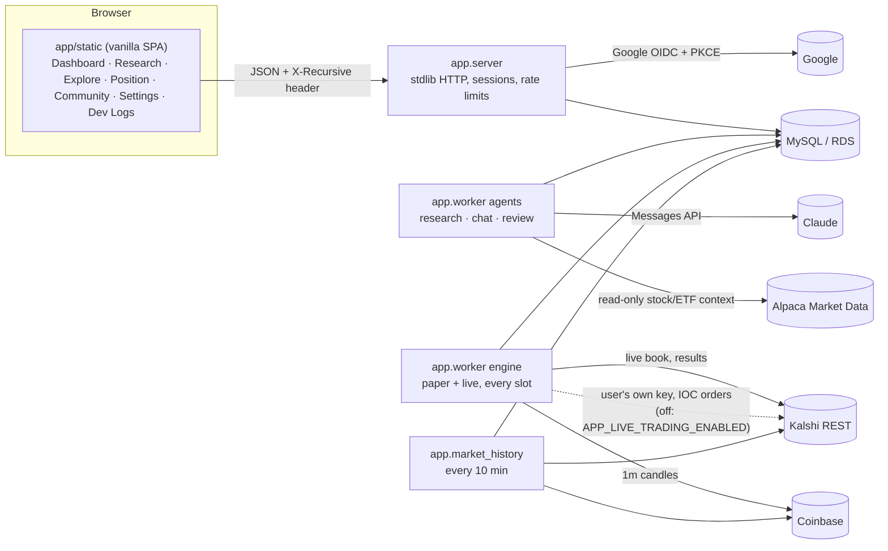
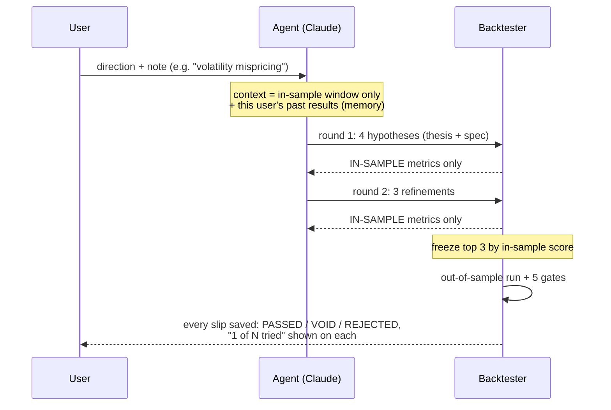

# Tau (v0.1)

The customer product: Google sign-in, agents that research Kalshi Bitcoin markets, a
backtest gate the agent cannot game, paper-first deployment, and a co-pilot chat.
Product truth is in `../PRODUCT.md`; the operator console (`data_pipeline/dashboard_server.py`)
is unchanged and separate.

For the teammate deploying this code, see [API credentials and server injection](DEPLOYMENT_SECRETS.md).
Alpaca, Massive, Databento and Exa market-data/news credentials use five encrypted GitHub
Actions Secrets; a clone does not contain them. Tau’s ignored private `.env` also
contains the configured keys. The guide covers explicit runtime injection through
Actions or AWS, including the existing loader’s Alpaca limitation. No provider or
production service was activated by the credential sync.

## Broker account authorization — local implementation

Source is available for review in [PR #10](https://github.com/JihuiTanUchicago/kalshi_trade/pull/10).
The teammate should follow [the deployment guide](BROKER_OAUTH_DEPLOYMENT.md);
main merge, production installation and real consent remain pending.

Funds (Settings → Account in Meridian) adds Alpaca Connect, Robinhood Trading MCP and approved IBKR
OAuth1a connections, with session-bound state and encrypted per-user grants.
Alpaca defaults to paper/read access; order authorization is an explicit option.
Existing data keys are separate from OAuth client credentials. Provider app
registration, real consent, database migration and production acceptance remain
required. This does not enable Tau trading or invoke broker order tools.
See [broker setup, API contract and acceptance](BROKER_OAUTH.md).

Latest Alpaca check: OAuth client ID/secret are present in the private local env;
112 focused offline tests and paper/data authorization URL construction pass.
The public broker callback and asset return 404, so the new code is not available
there yet. Local `APP_SECRET_KEY` is absent; production must retain its persistent
key. Deployment/runtime injection, migration and genuine consent remain pending.
[Configuration and public-readiness receipts](../results/broker_oauth_2026-10-17/credentials_2026-10-17/HANDOFF.md).
The Alpaca OAuth pair is now encrypted in GitHub Secrets (seven names total).
Production deployment is assigned to the teammate. The [operator guide](BROKER_OAUTH_DEPLOYMENT.md)
provides source, private credential access, the reviewed full-app schema migration, whole-app
installation, verification and rollback, with full 1,020 Python / 55 frontend
checks passing. No production
service or database has changed. [Rollout handoff](../results/broker_oauth_2026-10-17/production_2026-10-17/HANDOFF.md).

## Source publication — October 17, 2026

[PR #9](https://github.com/JihuiTanUchicago/kalshi_trade/pull/9) is merged on GitHub
main as `1df5d4f`. The source was reconciled with main `5da1922`, including its newer
sandbox hardening, execution controls and research-paper strategy detail. It adds
the local provider/knowledge tools and Tau workspace while preserving those
upstream paths. Infrastructure regression: **878 passed / 9 skipped**; sibling:
**137 passed / 22 skipped**; frontend **43 passed**, plus 11 synthetic browser
route/theme checks and focused control interactions. Independent review and
GitHub confirmation are recorded in the [publication handoff](../results/github_main_merge_2026-10-17/HANDOFF.md).
Source publication does not deploy services or enable providers/trading. Existing
provider entitlements and real queued worker/model acceptance still apply.

## Prior local integration milestone — October 17, 2026

Local main now includes GitHub main `0bd3bcf` (67 commits after `f8ff5e2`) plus the
reconciled local provider, knowledge and frontend changes. The research adapters
retain upstream streaming, partition/gatekeeper and cancellation/billing behavior.
The Tau workspace retains its artifacts/chat/Settings alongside upstream live feed,
pause/resume, funding buckets and gated deployment controls. Meridian keeps its
matching upstream bundle. Existing rollout/entitlement gates below still apply.

Shared-checkout validation: **849 infrastructure Python tests passed / 9 skipped;
137 sibling tests passed / 22 skipped; 39 frontend tests passed**. Eleven synthetic
browser route/theme checks and focused research/control interactions also pass;
these do not establish authenticated production behavior. Private environment files
and historical evidence are preserved. Changes remain uncommitted and no upload,
deployment, migration or live activation occurred.

[Daily release notes](../results/main_integration_2026-10-17/RELEASE_NOTES.md) ·
[Integration, verification and recovery](../results/main_integration_2026-10-17/HANDOFF.md).

## Exa web and publication research — October 17, 2026

Exa provides on-demand web/news search, publication discovery and selected-page
reading through the actual research and copilot entry points. Native HTTPS uses
the existing requests dependency. The model adapter composes with the market-data
loop, and every extra model reply is metered once. One knowledge context and cache
survives all chunks of a continuous research job. Web evidence is not an executable
strategy feature.

### Configuration and activation

Put the real EXA_API_KEY in this product's ignored .env or the server secret store.
Keep .env.example blank. The agent worker must explicitly load its environment;
TAU does not automatically source this file. The supplied key is present locally,
and both TAU_EXA_ENABLED=1 and TAU_EXA_HISTORICAL_ENABLED=1 are set in the private
file at the user's request. No local agent/server process was running to restart;
server-worker configuration/activation is separate.
New installations remain disabled until configured:

```dotenv
EXA_API_KEY=
TAU_EXA_ENABLED=0
TAU_EXA_HISTORICAL_ENABLED=0
```

```bash
# Configuration check only, using the already-loaded worker environment:
python -m app.exa_data status
# Set TAU_EXA_ENABLED=1 in that environment to enable current-time web research.
# Historical retrieval additionally needs Snapshot entitlement and
# TAU_EXA_HISTORICAL_ENABLED=1.
```

There are **no Exa application spending, request, batch or tool-round quotas**.
The retired TAU_EXA_MAX_REQUESTS_PER_RUN, TAU_EXA_MAX_COST_PER_RUN_USD and
TAU_EXA_MONTHLY_BUDGET_USD variables are ignored even if an older server retains
them. The unpublished budget-only DAO and table definition were removed; there is
no Exa quota-table migration or mandatory budget database dependency. No existing
database table was dropped or migrated.

Exa's own plan, account credit, rate limits and Snapshot entitlements still apply.
Unrelated market-data budgets, model credit billing and trading safeguards retain
their existing behavior. The optional secret loader supports /recursive/EXA_API_KEY,
TAU_EXA_ENABLED and TAU_EXA_HISTORICAL_ENABLED. It was syntax checked, not run;
its normal behavior restarts services and belongs to an authorized deployment.

### Tools, provenance and source links

The agent may return a nonempty list of exclusive knowledge_requests instead of its
normal task response or market_data_requests:

```json
{"knowledge_requests":[{"kind":"search","query":"latest policy announcements relevant to Bitcoin markets"}]}
```

```json
{"knowledge_requests":[{"kind":"publications","query":"prediction market probability calibration papers"}]}
```

```json
{"knowledge_requests":[{"kind":"contents","source_id":"exa:HOST_RETURNED_SOURCE_ID"}]}
```

Search sends query, Auto and highlights, without an application numResults override
or five-result truncation. Current publication searches use the documented
publication category. Contents reads one page returned earlier in the same run;
the model cannot supply arbitrary URLs, endpoints, crawl settings or dates. The
loop continues until the model returns task JSON or the job is stopped/fails. A
run-local cache lasts 60 seconds for current reads; historical cached reads preserve
their original cutoff and timestamps. No automatic initial search is performed.

Existing per-run events retain URL, publisher host, optional title/author/date,
retrieval/first-seen time, cutoff, excerpt kind/hash, explicit availability/truncation,
provider request ID and reported_cost_usd when supplied. Cached receipts retain the
original cost telemetry and are marked cached; they are not a new charge. Missing
cost remains unknown, and transport failures may still incur provider charges.
Reported costs are telemetry, not an independently reconciled invoice or an estimate
used to deny retrieval. Exa charges remain separate from TAU model credits.

Transport time/response size and added model context stay bounded to protect the
worker: streamed responses at most 1 MiB; added evidence context at most 24,000
characters, with explicit clipping. Cancellation is checked between requests and
response chunks. These controls do not impose a cumulative request/spending quota.
No automatic paid retries occur; provider errors are explicit and sanitized.
Credentials and raw error bodies stay out of model prompts and event records.

Final replies may add source_ids; hypotheses may add them beside their thesis.
Only IDs retrieved in this run are accepted. The host adds public source links to
the existing answer/thesis fields. Omitted IDs produce a Sources retrieved audit
trail, without asserting that every generated statement is supported. Hashes identify
returned text/highlights, not an independently verified copy of the whole website.
Sources remain private to the run's existing access controls.

### Historical boundaries

The current-time copilot can use live web evidence. Historical research additionally
requires explicit Snapshot activation and pins Search content and Contents to the
host's training cutoff. Publication intent in this mode is expressed in the query
because Snapshot does not support category. Missing entitlement, exhausted provider
access, unknown sources or altered restrictions fail visibly; there is no current-web
fallback. Later-dated results are withheld and unknown publication dates remain unknown.

Exa documents a rolling five-month pay-as-you-go Snapshot window and a 100-request
allowance before sales approval. Removing application quotas does not remove those
provider constraints. Snapshot pins content while discovery/ranking uses current
signals, so receipts state historical_ranking=false and qualified_backtest_features=false.
This is not a complete historical news archive, first-publication latency measurement
or proof of news-driven alpha; model/background-knowledge hindsight remains possible.
Both local Exa flags are enabled. After the user switched to pay-as-you-go, actual
historical Search, selected-page Contents and publication-intent Search passed
through the knowledge adapter with HTTP 200. All reads retained the host cutoff;
no live-web fallback was used. The earlier SNAPSHOT_NOT_ON_PLAN results, when only
a payment card had been added, remain preserved as historical evidence.

### Verification and remaining gates

Offline regression covers native HTTP decoding, real research/copilot entry points,
retrieval beyond the retired quotas, batches, continuous jobs, multiple users,
source/cutoff isolation, citations, cancellation, error billing and interleaved market
data. Credentialed read-only provider and scripted-adapter checks are recorded in
the follow-up handoff; these are distinct from a real queued model/worker canary.
Production worker configuration/deployment and real model acceptance remain pending.
Prior offline verification: **80 Exa tests; 558 passed and 7 opt-in MySQL skipped**
in the full suite. Those runs are recorded in the implementation handoffs; this
account-state acceptance did not repeat the unchanged code's full suite.
The latest historical test returned **10 Search sources, 1 Contents page and 10
publication-intent sources**, all with HTTP 200 and cutoff 2026-10-10T08:53:56Z.
Evidence reached the actual adapter's scripted model prompts, host source links
were added and an identical historical cache repeat made no additional HTTP call.
Provider-reported costs were absent for all three Snapshot requests, so cost is
unknown. Earlier current-web acceptance and the intermediate 403 diagnostics are
retained separately. Synthesis was scripted; real LLM/queued-worker/production
acceptance is still pending.

```bash
.venv/bin/python -m pytest tests/test_exa_data.py tests/test_agent_knowledge.py tests/test_agent_exa_integration.py -q --tb=short
.venv/bin/python -m pytest tests/ -q --tb=short
# Explicit real provider check; loads only the key from the private .env:
PYTHONPATH=. .venv/bin/python results/exa_integration_2026-10-17/unlimited_2026-10-17/live_check.py
# Historical adapter acceptance using the actual private activation settings:
PYTHONPATH=. .venv/bin/python results/exa_integration_2026-10-17/paygo_acceptance_2026-10-17/live_check.py
```

References: [Search](https://exa.ai/docs/reference/search),
[Contents](https://exa.ai/docs/reference/get-contents),
[Snapshot](https://exa.ai/docs/search/snapshot).
Passing historical acceptance (local archive: `../results/exa_integration_2026-10-17/paygo_acceptance_2026-10-17/HANDOFF.md`) ·
Quota-removal implementation evidence (local archive: `../results/exa_integration_2026-10-17/unlimited_2026-10-17/HANDOFF.md`).
The earlier integration handoff is retained as historical evidence; its quota policy
was superseded by this follow-up at the user's request.

## Configurable primary data and production setup — October 18, 2026

Databento can now be selected as the primary historical-bar provider with
`TAU_MARKET_DATA_PRIMARY=databento` and an explicitly allowlisted
`TAU_DATABENTO_DEFAULT_DATASET`. Omitted-provider bar requests follow that route;
explicit providers stay explicit and no error triggers vendor/feed fallback.
Historical research avoids the duplicate automatic Alpaca history watchlist when
Databento is primary. Downloads remain on demand and respect training cutoffs.

Databento is **not** a complete replacement for the existing feeds: Tau has no
Databento live ingestion or options-chain/Greeks workflow, and currency/rate
futures do not replace spot FX or published macro observations. Retain Alpaca
current snapshots and Massive FX/rates/options tools as needed. Brokerage OAuth
is separate from market-data selection.

The [production setup guide](MARKET_DATA_DEPLOYMENT.md) includes the official
coverage comparison and a dedicated [configuration template](../config/market-data/.env.example).
`scripts/configure_market_data.py` validates locally without network calls and
optionally writes a separate protected `.env.market-data`; the updated agent
service loads it last and runs an offline preflight before starting. It leaves
auth/billing/encryption settings and other services alone. Existing installs keep
their Alpaca default unless configured otherwise. No production action occurred;
provider entitlements, durable data-cost accounting and a real queued worker/model
canary remain acceptance gates. [Implementation evidence](../results/databento_primary_2026-10-18/HANDOFF.md).

## Databento historical data for agents — October 17, 2026

`app/databento_data.py` connects on-demand historical OHLCV reads to the same
research/copilot request loop as Alpaca and Massive. The implementation supports
both stock/ETF raw symbols and individual futures contracts. It is **implemented,
offline tested and locally verified with authenticated provider data**. It remains
disabled by default; no live stream or production worker was activated.

The adapter uses the documented HTTP API and the existing `requests` dependency.
No SDK installation, database migration or frontend change is required. Datasets
are independently selected by the operator; there is no provider fallback.

October 17 credentialed follow-up: **10 SPY minute bars** (`EQUS.MINI`) and **10
ESZ6 minute bars** (`GLBX.MDP3`) for October 16, 14:00–14:10 UTC reached the actual
Tau data-request loop using real HTTP and a scripted local model. The user removed
the spending ceiling for this validation. Estimated/reserved cost was
**$0.000006258488** for SPY and $0 for futures; vendor billing was not reconciled.
A cached repeat made no additional HTTP requests or reservation. The key was
restored after an external environment-file change interrupted the first attempt;
that diagnostic is retained. Persistent configuration, credentials and runtime
source were not edited by the test. A genuine queued worker/model remains unaccepted.
Credentialed evidence (local archive: `../results/databento_integration_2026-10-17/live_2026-10-17/HANDOFF.md`).

| Context | Example dataset and symbols | Supported reads |
| --- | --- | --- |
| U.S. stocks/ETFs | `EQUS.MINI`: `SPY`, `QQQ`, `AAPL` | Raw historical 1-minute, 1-hour and UTC daily bars |
| CME futures | `GLBX.MDP3`: explicit contract such as `ESZ6` | Same native bars, without contract rolling or back adjustment |

Dataset examples follow Databento's [equities Mini](https://databento.com/docs/venues-and-datasets/equs-mini)
and [CME feed](https://databento.com/docs/knowledge-base/datasets/glbx-mdp3)
specifications. Dataset coverage is not assumed to be consolidated U.S. market
coverage. Futures prices retain their instrument's price units; no USD currency
or comparable notional exposure is inferred. Current raw symbols must be supplied
with their exchange spelling. Parent, continuous and all-symbol requests are rejected.

Use **this product's ignored `.env`**, alongside its other API credentials. Empty
Databento settings have been appended locally without altering existing values;
fresh checkouts can use `.env.example`. The worker/CLI must explicitly load the
file into its environment. Configuration is server-side only:

```dotenv
DATABENTO_API_KEY=
TAU_DATABENTO_ENABLED=0
TAU_DATABENTO_DATASETS=
TAU_DATABENTO_MAX_COST_USD=0
```

Set the key privately. Select only datasets licensed for Tau's intended use,
for example `EQUS.MINI,GLBX.MDP3` if both are entitled. Keep activation at `0` until
the entitlement and cost settings are ready. The application's provider key and
raw response bodies never enter model prompts, run events or browser settings.

From `kalshi_trade_infra`, after loading `.env` into the process environment:

```bash
.venv/bin/python -m app.databento_data status
.venv/bin/python -m app.databento_data estimate SPY --dataset EQUS.MINI --start 2026-10-01 --end 2026-10-16 --timeframe 1Hour
.venv/bin/python -m app.databento_data estimate ESZ6 --dataset GLBX.MDP3 --start 2026-10-01 --end 2026-10-16 --timeframe 1Hour
```

`status` is local and makes no network request. `estimate` reads availability and
cost metadata without downloading time series. The matching `bars` command
performs the download after a fresh cost check; direct CLI reads do not depend on
the agent enable flag. Dates above are examples, not a promised availability range.

Once configured, `TAU_DATABENTO_ENABLED=1` exposes the provider to actual research
and copilot calls. No watchlist is downloaded automatically. The model requests:

```json
{"market_data_requests":[{"provider":"databento","kind":"bars","dataset":"EQUS.MINI","symbols":["SPY"],"timeframe":"1Hour","lookback_days":7}]}
```

- The host fixes the window; research stays inside the training start/cutoff.
  Per-schema entitled availability can narrow that window, explicitly reported by
  `requested_start`, `requested_end_exclusive`, `start`, `end_exclusive`,
  `availability_clipped` and `complete=false`. Only fully completed intervals are
  exposed. `1Day` means UTC midnight boundaries, including across U.S. DST.
- Every download first checks `metadata.get_cost` for the same dataset, symbols,
  schema, window and record limit. Unknown/invalid or over-budget estimates stop
  before downloading. `TAU_DATABENTO_MAX_COST_USD=0` permits only a zero estimate.
  Estimates are reserved before attempts and retained after errors because
  some bytes may already have been billed. Downloads are never automatically
  retried. Only metadata retries, at most three attempts with bounded backoff.
- The decimal budget is shared across requests and repeated `ask` calls on one
  `AgentMarketData` context. A research exploration chunk creates a context; a
  copilot response creates another. **This is an estimate guard, not a hard vendor
  billing cap or persistent account/user/run-wide budget.** It resets in a new
  context/process, and provider charges are not debited from Tau's model credits.
  Durable data-cost accounting is required before broad paid worker rollout.
- Shared limits: two data requests per model reply and two data rounds. Databento
  permits 12 HTTP attempts per task response, counting metadata and downloads;
  1–90 days and eight raw symbols per request; at most 10,000 records and 8 MiB of
  downloaded JSON, with bounded timeouts/duration and cancellation checkpoints.
  Oversized/partial/ambiguous data fail visibly rather than becoming a full series.
- Existing credential-isolated LRU caching applies: 60 seconds for copilot reads,
  300 seconds for historical research, 16 entries shared across providers. Cache
  hits do not download or reserve another estimate; they expose `cache_hit=true`
  and the current context's reserved amount. Cache is in-process, not a warehouse.
- Context retains instrument/publisher IDs, raw-price provenance, missing symbols,
  full-window summaries and the last 12 completed bars. Gaps are not filled.
  Signed futures prices are supported; non-positive closing prices suppress
  percentage-return summaries. Historical revisions are possible, so this is
  explicitly not a point-in-time vintage archive.

These bars are supplementary research evidence. The current executable strategy
language, Kalshi backtester and order engine do not gain equity/futures features.
Live streaming, tick/order-book schemas, continuous futures construction and a
durable data warehouse remain separate integration stages.

For AWS, the secret loader now supports `/recursive/DATABENTO_API_KEY` and the
three `/recursive/TAU_DATABENTO_*` settings. It has not been executed; running it
restarts services. Confirm the selected datasets' commercial, non-display,
redistribution and external-model processing rights before customer activation.
Then validate a small explicitly budgeted provider read and a queued worker/model
canary. Verification and handoff (local archive: `../results/databento_integration_2026-10-17/HANDOFF.md`).

Provider contracts: [Historical HTTP API](https://databento.com/docs/api-reference-historical?historical=http),
[cost estimates](https://databento.com/docs/api-reference-historical/metadata/metadata-get-cost),
[OHLCV timing and fields](https://databento.com/docs/schemas-and-data-formats/ohlcv).

## Massive FX, rates and options for agents — October 17, 2026

`app/massive_data.py` supplies read-only REST data to the existing agent loop in
`app/agent_market_data.py`. Alpaca continues to supply stock/ETF data independently.
Both integrations are disabled by default and use the existing model metering,
run events and research cancellation path. There are no new dependencies or tables.

October 17 credentialed local checks: the supplied key returned 120 EUR/USD hourly
bars, 20 Treasury observations and 31 funding observations. Tested SPY chains and
current EUR/USD BBO both returned HTTP 403. No subscription, worker flag or server
state was changed. Data reached a scripted model through the agent context; a real
production model/worker is still unaccepted. Full regression: **383 passed, 7 MySQL
skipped**. Live evidence (local archive: `../results/massive_integration_2026-10-17/live_2026-10-17/HANDOFF.md`).

| Dataset | Historical research | Current-time copilot |
| --- | --- | --- |
| FX | Completed quote-derived bars within the training window | Historical bars; current bid/ask quotes with a realtime entitlement |
| Treasury yields and funding conditions | Denied: observation dates do not establish historical release/vintage availability | Daily history, including SOFR, effective fed funds and the Treasury curve |
| Option chains | Denied: current Greeks/IV are not historical inputs | Filtered chains with prices, Greeks, IV and prior-day open interest |

Put the **real key only in this product's ignored `.env`** or the server secret
store. The tracked `.env.example` must keep `MASSIVE_API_KEY=` empty. A blank local
`.env` has been prepared in this checkout; in a fresh checkout, copy `.env.example`
to `.env`. Existing credential files are preserved. This app does not automatically read the standalone `/Users/.../Polygon/.env`.
The process must load the environment explicitly. From `kalshi_trade_infra`, after
filling the key locally:

```bash
set -a
. ./.env
set +a
.venv/bin/python -m app.massive_data status
.venv/bin/python -m app.massive_data fx-bars EURUSD --start 2026-10-01 --end 2026-10-15 --timeframe 1Hour
.venv/bin/python -m app.massive_data macro treasury_yields --start 2026-10-01 --end 2026-10-15
.venv/bin/python -m app.massive_data macro funding_conditions --start 2026-10-01 --end 2026-10-15
.venv/bin/python -m app.massive_data options-chain SPY --expiration-date 2026-10-23 --contract-type call --strike-min 550 --strike-max 650
```

The dates/strikes above are examples; choose a current valid expiry and relevant
strikes. `status` checks configuration only; the other commands make real read-only
requests. Once the subscription is verified, set `TAU_MASSIVE_ENABLED=1` in the
actual agent worker environment. Adding a key alone does not activate agent reads.

- `TAU_MASSIVE_FX_FEED=end_of_day` is the default. It queries completed prior UTC
  days. Use `realtime` only with matching Currencies access; then
  `python -m app.massive_data fx-quotes EURUSD USDJPY` reads current BBO quotes.
  A denied entitlement is returned as unavailable, with no silent fallback.
- `TAU_MASSIVE_FX_SYMBOLS=EURUSD,USDJPY,GBPUSD` controls the automatic FX context.
  At most three pairs are accepted. FX candles derive from quotes, so consolidated
  executed volume is deliberately absent; vendor quote activity is labeled separately.
- `TAU_MASSIVE_DATASETS=fx,treasury_yields,funding_conditions,options` controls
  available datasets. Remove any datasets your subscription does not include.
  Copilot receives FX and daily rates automatically. Options are requested on demand.
  Historical research receives only completed FX bars before its training cutoff.
- Each option request returns at most **50 contracts**, sorted by strike. The
  `complete` flag identifies a truncated chain. Filter by expiration, call/put and
  strike bounds before comparing contracts. Missing Greeks/IV stay unknown; quotes
  and underlying prices carry separate timestamps. Open interest is prior-day close.
- Macro output identifies observation dates and `point_in_time=false`. The agent
  receives a count and the last 12 observations, with stale observations flagged.
  `latest_values` also retains each series' last non-null value and its own
  observation date/age/stale flag, including a series outside the 12-row sample.
  A newer policy-rate observation does not refresh an older SOFR observation.
  Rates use percent; funding volumes use billions of USD. These are daily published
  observations, not live interest-rate ticks or a historical-vintage database.
- Bounds: two requests per model response, two data rounds per task response, and
  **18 Massive HTTP attempts total** per response, including initial context,
  pagination and retries. FX history permits 1–90 days and five bar timeframes;
  each pair/dataset has three-page/5,000-row caps. Oversized history fails visibly
  instead of returning an apparently complete partial dataset. HTTP uses three
  attempts, bounded backoff/timeouts, fixed allowlisted HTTPS paths and no redirects.
- Current reads cache for 60 seconds; historical and daily macro reads for 300
  seconds, with 16 entries per process. Entries are isolated by provider, credential,
  feed, enabled datasets and query window. Quote/underlying freshness is recalculated
  on cache hits; prices older than 180 seconds are stale. Macro observation age is
  labeled separately. Shared helpers retain the previous Alpaca behavior.

An agent request uses the existing exclusive JSON channel:

```json
{"market_data_requests":[{"provider":"massive","kind":"fx_bars","symbols":["EURUSD"],"timeframe":"1Hour","lookback_days":7}]}
```

Other kinds are `fx_quotes`, `macro` (with `dataset` and `lookback_days`) and
`options_chain` (one stock symbol, optional `expiration_date`, `contract_type`,
`strike_min`, `strike_max`). Requests without a provider use the configured primary
for bars (Alpaca by default); Massive requests always specify their provider.
These series are research context; no FX/options strategy, backtest input or order
execution is added to the existing Kalshi strategy engine. Continuous WebSocket
ingestion, a durable market-data warehouse and geopolitical news remain separate work.

For AWS, store `MASSIVE_API_KEY` as a SecureString at `/recursive/MASSIVE_API_KEY`.
The updated `scripts/load_app_secrets.sh` also loads the four `TAU_MASSIVE_*`
settings from equivalent `/recursive/VARIABLE` paths into `/opt/kalshi/.env.app`,
which the checked-in worker unit sources. Its instance role needs SSM/KMS read
permission. The loader restarts services when an operator runs it; **it was not
run for this integration**. Deployment, subscription rights and a controlled real
worker/model canary remain separate acceptance gates. A multi-user TAU service
needs the appropriate commercial/non-display/redistribution agreement with Massive.

Provider contracts: [FX bars](https://massive.com/docs/rest/forex/aggregates/custom-bars),
[FX quotes](https://massive.com/docs/rest/forex/quotes/last-quote),
[Treasury yields](https://massive.com/docs/rest/economy/treasury-yields),
[funding conditions](https://massive.com/docs/rest/economy/funding-conditions),
[option chains](https://massive.com/docs/rest/options/snapshots/option-chain-snapshot).
Synthetic HTTP/model tests do not establish real subscription access or production
availability. Verification and handoff (local archive: `../results/massive_integration_2026-10-17/HANDOFF.md`).

## Alpaca stock/ETF data for agents — October 16, 2026

`app/alpaca_data.py` reads US stock/ETF snapshots and historical OHLCV bars from
Alpaca. `app/agent_market_data.py` connects those reads to the actual research and
copilot worker functions. No new dependency, database table or browser credential
is required. This is market-data context; the Kalshi strategy language, backtester
and order engine still evaluate Kalshi contracts. Equity strategy execution is a
separate integration.

Configure the **agent worker's server environment** using its existing env file or
secret manager. TAU does not automatically load the standalone Polygon `.env`.
Use the existing Alpaca key pair as `APCA_API_KEY_ID` and `APCA_API_SECRET_KEY`, then:

```bash
export TAU_ALPACA_ENABLED=1
export TAU_ALPACA_FEED=iex
export TAU_ALPACA_SYMBOLS=SPY,QQQ,IWM,TLT,GLD,USO
python -m app.alpaca_data status
python -m app.alpaca_data snapshots SPY AAPL
python -m app.alpaca_data bars SPY --start 2026-09-01 --end 2026-10-01 --timeframe 1Hour
python -m app.worker agents
```

`status` checks configuration only; `snapshots`/`bars` perform real read-only
requests. Enabling this feature never calls a brokerage/order endpoint.
`iex` is explicitly **IEX-only**, including its volume and quotes. Set `sip` only
with matching entitlement; a denied feed returns a visible error and is never
silently downgraded. Multi-user/commercial data rights remain an operator gate.

The agent receives the configured watchlist automatically. It can request other
symbols using its existing JSON response channel, for example:

```json
{"market_data_requests":[{"kind":"bars","symbols":["AAPL","MSFT"],"timeframe":"1Hour","lookback_days":7}]}
```

The host executes the reads and returns data before the next model response. A
current-time copilot may request `{"kind":"snapshots","symbols":["SPY"]}`.
Data requests are exclusive of actions/hypotheses; only the final validated task
response can propose existing actions. All model calls, including data-request
rounds, use the existing usage/billing path. Research cancellation is checked
before additional model/data operations.

- **Research:** raw, completed bars end at the existing training cutoff; lookback
  is also clamped to the training start. Current snapshots are denied. The data
  is supplementary context, not a new executable feature or proof that an equity
  strategy passed a backtest.
- **Copilot:** latest trades/quotes and bars carry provider, feed and timestamps.
  Snapshot freshness is recalculated even on cache hits; crossed/one-sided quotes
  are not usable current quotes. Prices older than 180 seconds are marked stale.
  Historical copilot reads end at least 20 minutes ago to accommodate Basic-plan
  history restrictions; snapshots supply current prices.
- **Bounds:** eight symbols/request, two requests/response, two data rounds/task
  response, 1–90 lookback days, five pages/10,000 raw bars per historical read.
  Bars support `1Min`, `5Min`, `15Min`, `1Hour`, `1Day`. Requests use fixed HTTPS
  data endpoints, three attempts, bounded timeouts/backoff and no redirects.
- **Evidence:** run events retain the data actually supplied to the agent.
  Historical context contains full-window statistics plus an explicitly labeled
  sample of the last 12 completed bars. Per-process caches retain current reads
  for 60 seconds and historical research reads for 300 seconds, isolated by feed,
  credentials and query window. A provider failure is reported as unavailable.
- **Limits:** no streaming collector, persistent equity warehouse, corporate-action
  tables, historical universe or equity broker/account integration is added.
  Raw vendor history can include later corrections; the cutoff prevents later
  intervals from entering the prompt but does not create a certified point-in-time
  dataset. Feed credentials stay in the server process and out of model context.

Verification on the clean PR branch: **258 Python tests passed, 7 opt-in MySQL tests skipped**. A separate
read-only local IEX check delivered a real SPY trade/quote snapshot and 44 hourly
bars to a scripted agent, with the historical sample before the cutoff. Production
worker activation and live-model acceptance remain pending. See the
[implementation status](../PLAN.md) for remaining gates.

Verified locally: **291 Python tests passed, 7 opt-in MySQL tests skipped**;
read-only live IEX smoke checks delivered a SPY trade/quote snapshot and 44 hourly
bars to a scripted agent, with the historical sample before the cutoff. No paid
model call or production worker deployment was performed. [Evidence and activation
gates](../results/alpaca_market_data_2026-10-16/HANDOFF.md).

## GitHub main compatibility — October 16, 2026

October 17: local main is now `f8ff5e2`, including merged Alpaca PR #8 and the theme
switcher. **Settings → Theme** selects Tau or Meridian; Tau keeps the local
Research/artifact and Account/Billing/System layout. Bootstrap is external for
CSP compatibility and loads after the three local helper scripts. The read-only
preview at `http://127.0.0.1:8090/preview` permits preview-only theme switching;
trading/account writes remain disabled. Real preference persistence requires the
upstream `app_users.ui_theme` migration and a configured backend. No migration
was run during this sync. Verification (local archive: `../results/main_frontend_sync_2026-10-17/HANDOFF.md`).

The local Research/artifact workspace, Settings and dashboard preserve the latest
main features. Session grouping reads every strategy page; demo replay overlays
only saved backtests, and scenario/deployment state stays separate. The build
marker is a data attribute compatible with the server's existing script CSP. Session chat
still requires the session-scoped backend contract. Sync evidence and limits (local archive: `../results/local_github_merge_2026-10-16/HANDOFF.md`).

## Overview heading — October 16, 2026

Overview has the shared page-title style without its former subtitle/divider. New
research remains; live realized P&L/history freshness stay with account details.
Verification (local archive: `../results/overview_heading_cleanup_2026-10-16/HANDOFF.md`).

## Compact Hot Markets heading — October 16, 2026

All pages use the compact Hot Markets heading shown on Position. Dashboard no
longer expands it to match Overview. Toggle controls remain removed; the existing
panel width, navigation, quotes and phone layout remain.
Verification (local archive: `../results/hot_markets_compact_heading_2026-10-16/HANDOFF.md`).

## Hot Markets under the header — October 15, 2026

The black header now spans the viewport. Hot Markets and the page begin together
below it, sharing a grid row; narrow phones stack the panel below the header and
above page content. The dock retains its width reservation and chevron-only toggle.
Its height follows the remaining viewport while charts fit the page column.
Existing quotes, refresh, navigation, keyboard/focus and page content remain.
Verified with 282 browser assertions, 29 Node tests and 17 focused Python tests;
JavaScript syntax passes. GPT-6.1 Sol approved this integration at **9.2/10**.
Handoff and verification (local archive: `../results/hot_markets_header_2026-10-15/HANDOFF.md`).

## Hot Markets icon toggle — October 15, 2026

The left header toggle now uses double chevrons, right to open and left to close.
The black header label and quote-panel RIGHT NOW subtitle/dot are removed. The
panel title, accessible names/tooltips, keyboard/focus and dock behavior remain.
Verified with 57 browser assertions at 1280/1024/600/320px and JavaScript syntax.
GPT-6.1 Sol approved the refinement at **9.3/10**.
Handoff and review (local archive: `../results/hot_markets_toggle_2026-10-15/HANDOFF.md`).

## Hot Markets dock — October 15, 2026

Hot Markets toggles from the left of the shared header. Opening it reserves
248–306px beside the entire app above 600px; narrower phones show the panel above
the page in document flow. Closing reclaims the page width. Quotes, refresh,
persistence, navigation, keyboard focus and chart resizing are retained.

Verified across nine toggle widths and eleven routes at five widths: 246 browser
assertions, 29 Node tests and 17 focused Python tests pass. GPT-6.1 Sol approved
the integration at **9.2/10**. Local sample preview remains http://127.0.0.1:8090/.
Handoff and independent review (local archive: `../results/hot_markets_dock_2026-10-15/HANDOFF.md`).

## Frontend copy cleanup — October 15, 2026

Dashboard, Research/session/artifact/library, Explore/market, Position, Community
and Settings now use shorter copy. Repeated descriptions, tutorials, promotional
payment text and empty-state instructions are removed. Labels, actions, errors,
actual research/chat content, evidence, costs and financial safeguards remain.

GPT-6.1 Sol reviewed both revisions: **9.1/10**, then final **9.2/10**, approved.
123 browser assertions across desktop/phone and offline state fixtures, 29 Node
tests and 17 focused Python tests pass. This is local copy cleanup; real-account
acceptance and the separate visual design gate remain pending.
Handoff and review evidence (local archive: `../results/frontend_copy_cleanup_2026-10-15/HANDOFF.md`).

## Dashboard layout — October 15, 2026

Overview now starts with paper portfolio and open positions, then paper performance
and recent research. The account panels stack on phones; the full deployed table
and settled trades remain below. Existing Hot Markets behavior is unchanged.
This implements only the Dashboard portion of the approved preview.

Verified with 79 browser assertions at 320/760/1024/1440px, 29 existing Node tests,
17 focused Python tests and JavaScript syntax checks. Local sample preview: http://127.0.0.1:8090/.
Handoff and evidence (local archive: `../results/dashboard_layout_2026-10-15/HANDOFF.md`).

## Settings — October 15, 2026

The main navigation now has one **Settings** entry, with **Account**, **Billing**
and **System** sections. `/settings` opens Account; section deep links are
`/settings/account`, `/settings/billing` and `/settings/system`. Old `/funds`,
`/billing` and `/system` links resolve to their section. Operator `/admin` opens
restricted tools within System; ordinary users retain the existing denial.
API handlers, financial validation and server authorization are unchanged.

The page reuses existing forms and the full system map. Repeated introductions,
section headings and balance captions are removed. Kalshi setup and operator
tools expand when needed; auto-reload uses two labelled amount fields. Read errors
retain section navigation, and late reads cannot replace another section.
Local sample preview: http://127.0.0.1:8090/settings. Real account/payment operations
still require a configured backend. Handoff and verification (local archive: `../results/settings_integration_2026-10-15/HANDOFF.md`).

## Meridian frontend on local main — October 15, 2026

The selected Meridian/Catalyst styling is applied to the actual app: charcoal
navigation, neutral surfaces, local DM Sans, editorial research titles and tighter
panels, tables and transcript spacing. Overview uses existing session/dashboard
reads for recent research and paper portfolio data, with isolated read failures and
stale-response protection. The performance chart sums closed daily P&L over its labelled period, keeps loss
days and exposes daily values; zero/one-day fallbacks remain truthful. All existing Research artifacts, evidence, scenarios, deployment/auth gates,
Explore/Hot Markets and account screens remain. Scoped chat backend is still pending.

The local read-only sample preview is http://127.0.0.1:8090/preview. This is local
source integration, not a commit, remote merge or deployment. Fonts are bundled
with [their license](static/DM-Sans-OFL.txt); the static handler serves WOFF2 with
its restricted path validation and immutable caching.
Verified with 163 Python tests (7 opt-in MySQL skips), 29 Node and 183 browser
checks across five widths. Latest critic: 7.0/10; the earlier 9/10 visual gate remains
open. Integration handoff (local archive: `../results/meridian_main_integration_2026-10-15/HANDOFF.md`).

## Frontend cleanup — October 14, 2026

Session cards now use one native link each. Repeated status/instruction copy and
the constant custody metric are removed. Landing and empty-dashboard actions are
consolidated; an open desktop revision comparison owns its decision controls,
while mobile retains the controls needed for pane navigation. Only changed
parameters appear in revision diffs. Keyboard focus, drafts, costs, gates and
paper/live distinctions remain part of the UI contract.

Verified with 148 Python tests (7 opt-in MySQL skips), 22 Node tests and 28
read-only synthetic browser checks. Cleanup handoff and limitations (local archive: `../results/frontend_cleanup_2026-10-14/HANDOFF.md`).

## Architecture



Every process is stateless apart from MySQL, so each scales by running more copies:
agent runs are claimed with `SELECT … FOR UPDATE SKIP LOCKED`, engine decisions with a
per-deployment, per-slot claim (`claim_decision`), and every money write is idempotent.

## Research conversations and strategy artifacts

Before the Meridian presentation above, local main synchronized to upstream
`e40d060` (October 15) and applied frontend PR #5’s functional workspace, retaining Explore/Hot Markets, public scoped System, automatic
market choice, depth/run-forever controls, pagination and current credit/deployment
contracts. Artifact deployment retains upstream passed/void/rejected choices and
unvalidated-result warnings; Position highlights passed candidates. Scoped session
backend routes remain unimplemented. Verified on updated local main: 157 Python
passed (7 opt-in MySQL skips), 29 Node, 16 browser and 19 HTTP checks passed. The
read-only editing preview includes new deep links and synthetic Explore/Hot Markets
data; it remains separate from authenticated backend acceptance.
Sync evidence (local archive: `../results/local_main_frontend_sync_2026-10-15/HANDOFF.md`).

After completing the requested restoration, Research now owns research sessions
and their generated strategies. `/research` retains the original idea/market form
and run history, with **Browse all strategies** for the existing library/filters.

`/research/{id}` shows a session conversation on the **left** and opened strategy
artifacts in tabs on the **right**. The conversation includes the original idea,
agent activity and every available candidate status, including void/rejected
results. Open, switch or close tabs; keyboard arrows/Home/End also select them.
At <=800px, Conversation/Strategies buttons switch panes; opening a strategy
selects its pane and closing the last tab returns to conversation.

Each artifact retains the full restored strategy sheet: P&L, trades, return,
capital/tries, thesis, rules, equity curve, sample/unseen metrics, dataset dates,
latest trades, exact spec, gates and what-if controls. Tabs keep independent
scenario/reading state, and late responses cannot replace a different selection.
Scenarios are labelled separately; deployment uses the original saved rule/verdict.
The shared paper/live deployment component is also available under **Ready to
deploy** in Position. Existing deployments, Pause/Stop, positions, account-wide
chat/autopilot, Account, Billing, Community and Admin/System remain.

Full Tau has a **Strategy** tab between Research and Explore. `/strategies`
opens the existing filtered library, with Strategy highlighted separately
from Research; `/strategies/{id}` resolves to its research
workspace and opens the artifact. Adjustments follow available ancestors;
standalone/missing-ancestor artifacts retain their own review workspace. Owner-
scoped backend reads remain. The upstream 50-run window and 50-row library
pagination are retained. Session grouping and Position's ready list follow every
strategy page so older candidates and adjustments remain available.

**UI plus backend connection contract:** `session-chat.js` uses only the proposed
session-scoped endpoints in [SESSION_CHAT_API.md](SESSION_CHAT_API.md). The backend
still lacks those routes; the real handler shows Not connected, retains drafts
and disables sends/actions. Session drafts/open tabs survive SPA navigation in
this page instance, are isolated by user/session and are cleared on sign-out.
A browser reload resets that temporary state. Position's existing `/api/chat`
remains account-wide and is never a session fallback. Revision backtest/comparison
and manual approval controls retain their existing capability gates.

Verification from `kalshi_trade_infra/`:

```bash
node --check app/static/app.js
node --test tests/test_app_sessions.mjs tests/test_session_chat.mjs tests/test_research_artifacts.mjs
APP_TEST_MYSQL=0 AWS_EC2_METADATA_DISABLED=true .venv/bin/python -m pytest tests/ -q
```

Current evidence: workspace handoff (local archive: `../results/research_artifact_workspace_2026-10-14/HANDOFF.md`).
The completed restoration remains an independent historical receipt in
its handoff (local archive: `../results/separate_research_strategies_2026-10-14/HANDOFF.md`).
Local editing preview data/replies are synthetic; actions are disabled. Verification
also uses actual GET handlers plus explicitly enabled synthetic send/scenario
fixtures; no database, model, payment or trading operation is performed.

## Approved copy/control cleanup (October 15, 2026)

C1–C11 and B1–B2 are applied to the Research workspace and Position. One session
status/count, compact grouped message targets and accessible composer labels
replace repeated headings/instructions. Artifact direction, strategy IDs/titles,
evidence, scenarios and financial gates remain. Position retains each strategy's
stake and distinct paper/live controls, with one platform-wide live notice and
strategy-specific restrictions when applicable. Duplicate workspace/empty-state
navigation is removed; existing sections/library filters remain.

The editing fixture is labelled **Sample conversation**, with one current revision
card and its proposal/backtest stages still in the chronological messages. Only
synthetic demo invitations/history links changed; real message records and
backend routes are untouched. The real scoped API remains unimplemented and shows
Not connected. Evidence: cleanup handoff (local archive: `../results/research_ui_cleanup_2026-10-15/HANDOFF.md`).

## Upstream compatibility history (October 14, 2026)

Local main was fast-forwarded through 40 commits to `99a5399`, retaining Billing,
glossary, admin/System, Community reactions/photos/editing and payment gates.
That sync initially preserved the merged-session design; the restoration above
supersedes that presentation decision. Its **148 Python passed / 7 opt-in MySQL
skips; 22 Node passed** and actual-handler synthetic acceptance remain historical
receipts in the sync handoff (local archive: `../results/github_frontend_sync_2026-10-14/HANDOFF.md`).
Pinned PyArrow 17.0.0 was installed without starting any collector.

## The research loop (why it's "recursive")



The agent never sees out-of-sample numbers or even the out-of-sample dates while it
iterates. Each run's results become memory for the next run on that market.

## The rule (one implementation, two callers)

`app/spec.py` is the only decision logic. The backtester and the live engine both call
`entries()` / `exit_signal()` on snapshots built by the same `markets.snapshot()`, so a
deployed strategy trades exactly what passed.

```
fair P(YES) = Phi( (ln(S/K) + mu*T) / (sigma*sqrt(T)) )
  sigma = vol_scale * realised 1m vol (15 or 60 min)
  mu    = drift_beta * BTC return over drift_window / drift_window
edge(YES) = P - yes_ask        edge(NO) = yes_bid - P
enter when edge >= min_edge, price/tte/spread in range, all filters hold
exit: take_profit / stop_loss / edge decay, else hold to settlement
```

| Market | Kalshi series | Decision cadence | History |
|---|---|---|---|
| `btc15m` | KXBTC15M | every minute | 30 days of 1m candles |
| `btc_daily` | KXBTCD, 5pm EDT event only | every hour | 60 days of 1h candles (strikes within ±7% of BTC at open) |

Fills: buy at the ask, sell at the bid, Kalshi taker fee (`kalshi_fees`) on every fill,
settle on Kalshi's own `result`. Paper fills are capped at the size shown on the book.

## Gates (all must pass to deploy)

| Gate | Threshold |
|---|---|
| Makes money in-sample | > $0 |
| Makes money on unseen data | > $0 |
| Enough unseen trades | ≥ 10 |
| Unseen profit factor | ≥ 1.1 |
| Unseen worst drawdown | ≤ 50% of capital |

Agent adjustments (chat or autopilot) are re-backtested against the same gates before they
can be proposed or applied.

## Guardrails

* Autopilot may: apply gate-passing adjustments that don't raise stake or position count,
  deploy passed strategies **on paper**, and pause anything. It may never move money to
  live or resume a live deployment.
* Loss guard (engine, no model involved): a deployment that loses more than
  max(2 × its backtest's worst unseen drawdown, 50% of capital) is paused, and a review run is queued.
* Live for app users is off unless `APP_LIVE_TRADING_ENABLED=1`; live is YES-only, needs a
  connected key and a typed `LIVE` confirmation.
* Kalshi private keys are AES-256-GCM encrypted (`APP_SECRET_KEY`), bound to the user id.
* Limits: 2 concurrent / 12 daily research runs, 40 chat messages per hour, 10 active deployments.

## Run locally

```bash
docker run -d --name recursive-mysql -e MYSQL_ROOT_PASSWORD=devroot -e MYSQL_DATABASE=kalshi_trade -p 3307:3306 mysql:8.0
export MYSQL_HOST=127.0.0.1 MYSQL_PORT=3307 MYSQL_USER=root MYSQL_PASSWORD=devroot
python -m app.schema
python -m app.market_history            # leave running; first backfill takes ~20 min
APP_DEV_LOGIN=1 APP_INSECURE_COOKIES=1 python -m app.server   # http://127.0.0.1:8090/auth/dev
ANTHROPIC_API_KEY=... python -m app.worker agents
python -m app.worker engine
APP_TEST_MYSQL=1 python -m pytest tests/   # includes the money-path tests against MySQL
```

## Production environment (`/opt/kalshi/.env.app`)

| Variable | Purpose |
|---|---|
| `GOOGLE_CLIENT_ID`, `GOOGLE_CLIENT_SECRET` | OAuth client (Web application) |
| `APP_GOOGLE_REDIRECT_URI` | e.g. `https://<host>/auth/google/callback`, registered in Google Cloud |
| `APP_SECRET_KEY` | 32 random bytes, urlsafe base64 (`python -c "import os,base64;print(base64.urlsafe_b64encode(os.urandom(32)).decode())"`) |
| `ANTHROPIC_API_KEY`, `APP_AGENT_MODEL` | agent model (default `claude-sonnet-5-5`) |
| `APP_LIVE_TRADING_ENABLED` | leave unset until explicitly authorised |

CloudFront in front of the app must forward cookies and allow POST (the existing
distribution forwards no cookies and was GET-only until 2026-09-26).
