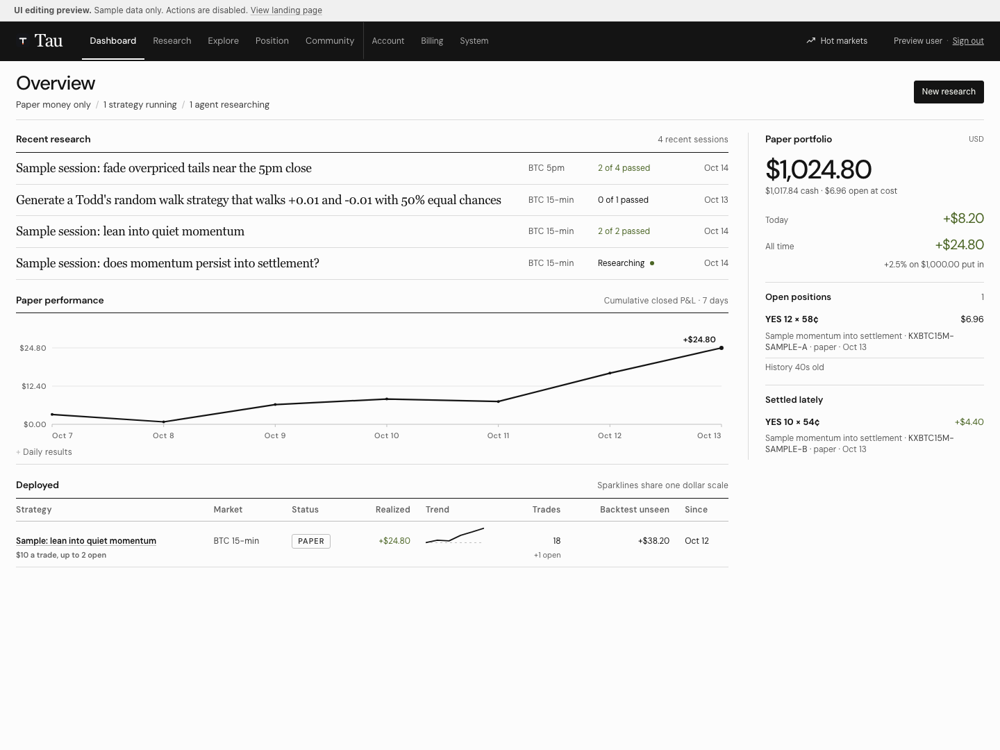
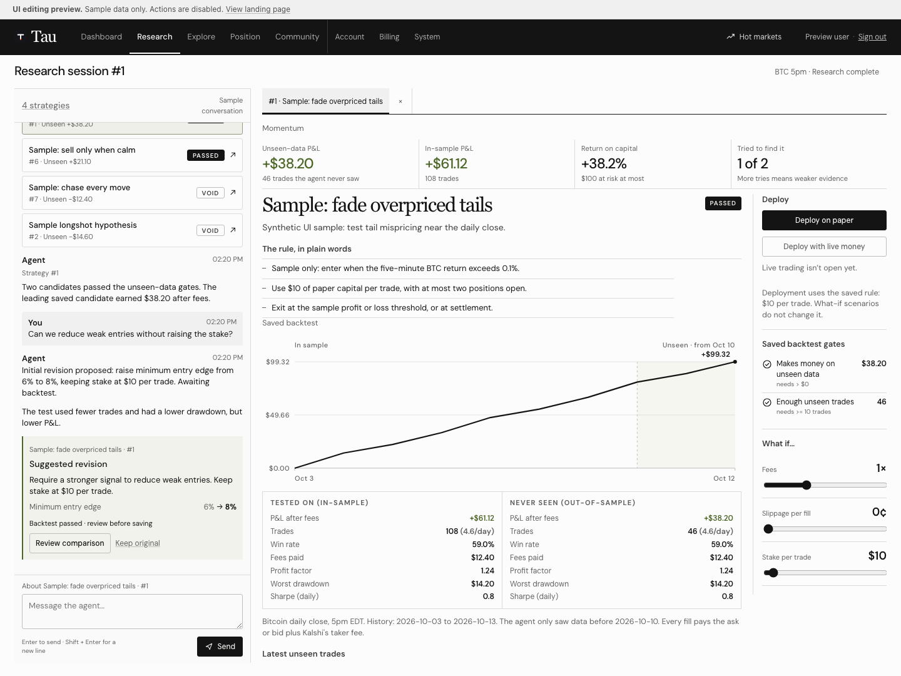
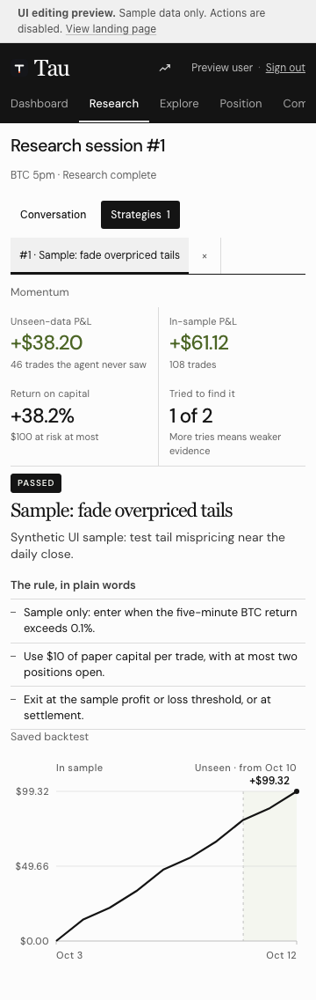

# Compact Meridian frontend review

Review candidate based on upstream `e40d060` on `codex/meridian-frontend-redesign`.
The exact executable application, font and focused test bytes match the frontend
verified locally. The copied license only normalizes CRLF/trailing whitespace; its
complete text is retained.
The earlier unmerged Research workspace and compact Meridian design are included
together; MVP edits, Polygon/feed work and the prototype gallery are excluded.
No merge, deployment, schema migration, provider or financial operation is included.

## Result

Research sessions put conversation/activity/all-status candidates on the left and
full strategy artifacts in closable tabs on the right. Keep original rules/spec,
saved evidence, dates/trades/gates, independent what-if state, original deployment
rule, keyboard/focus, mobile pane selection and per-session drafts/tabs. Existing
library filters and legacy URLs resolve under Research. Position retains shared
paper/live deployment controls, ongoing positions and account-wide chat/autopilot.
Explore/Hot Markets, System, Community, Account, Billing and all financial/auth
checks remain; the obsolete frontend System admin redirect is removed while
backend ownership/authorization remains.

Meridian adds neutral Catalyst-inspired surfaces, charcoal navigation, local DM
Sans/Georgia and compact rows/panels/transcripts. Research form height falls from
481px to 348px at 1440px; workspace heading from 55px to 27px; conversation
line-height from 20.15px to 18.2px. Touch controls retain 44px targets.

Overview adds an existing owner-scoped `/api/runs` read alongside `/api/dashboard`
every 15 seconds while visible. An optional session-read failure keeps balances
and deployments available; stale responses cannot replace another route. The
performance line sums closed daily P&L over the displayed period, preserving loss
days and daily values. It is never labelled account equity. A single header
Hot Markets trigger preserves the existing persistent drawer. Measured plots
redraw when the available width changes. Deployment sparklines share one dollar
scale and have a dedicated Overview column.

Backend changes only content-version the three frontend helpers, serve the bundled
WOFF2 font through the restricted static path, permit same-origin fonts in CSP,
and rename Funds to Account in an existing error. Repository, schema, workers,
execution logic and money/auth gates retain upstream behavior. The included font
and SIL license are local assets; no font CDN is required.

## Verification

**163 Python passed / 7 opt-in MySQL skipped; 29 Node passed; 183 browser checks
passed** in the isolated publication checkout. [Verification](VERIFICATION.json),
[source hashes](SOURCE_MANIFEST.json), [Python](PYTEST.txt), [Node](NODE_TESTS.txt),
[browser](BROWSER_CHECKS.json).

Browser checks cover all actual UI routes at 360/760/1024/1280/1440px, local fonts,
markets/depth, original evidence/guards, tab/draft retention, last-tab close,
selected phone navigation, drawer fit/resizing/focus, daily values/losses and
Overview success/empty/error/stale-response behavior. They use only synthetic
fixtures and local assets; no runtime errors or external requests occurred.
Static tests cover valid fonts, missing files and traversal errors. Browser
coverage is not authenticated provider or MySQL acceptance.

From `kalshi_trade_infra/`, with repository Python dependencies installed:

```bash
node --check app/static/app.js
node --test tests/test_app_sessions.mjs tests/test_session_chat.mjs tests/test_research_artifacts.mjs
APP_TEST_MYSQL=0 AWS_EC2_METADATA_DISABLED=true python -m pytest tests/ -q
python results/meridian_frontend_pr_2026-10-15/preview.py app/static 8097
```

In another shell, with Playwright available to Node and its Chromium installed:

```bash
node results/meridian_frontend_pr_2026-10-15/browser-check.mjs
```

The browser script defaults to port 8097. `TAU_PREVIEW_ORIGIN` overrides that URL;
`PLAYWRIGHT_MODULE` and `CHROMIUM_EXECUTABLE_PATH` optionally select an existing
module/browser, and `TAU_BROWSER_EVIDENCE_DIR` selects the screenshot output.
The preview is loopback-only and rejects application writes; `/preview` selects
its sample-data UI. This helper is separate from the production handler.

## Remaining gates

Session-scoped chat remains [UI plus backend contract](../../app/SESSION_CHAT_API.md).
Its routes/persistence/worker context/revision execution remain unimplemented.
Missing routes show Not connected, preserve drafts and disable sends/actions;
Position chat is never a fallback. Configured non-production MySQL/account/provider
acceptance remains pending.

The latest independent fresh-context screenshot critic scored **7/10**. The
requested **9/10 visual target remains unmet**; no studio-level acceptance is
claimed. Source snapshot reviews before publication scored 6.2, 6.5, 6.8, 7.0,
7.2 and 7.0. Each critic received only its current screenshot and the same prompt,
with no code, earlier feedback or completion threshold. This PR is for review.

## Screenshots

All displayed prices, balances, positions and conversations below are synthetic.




