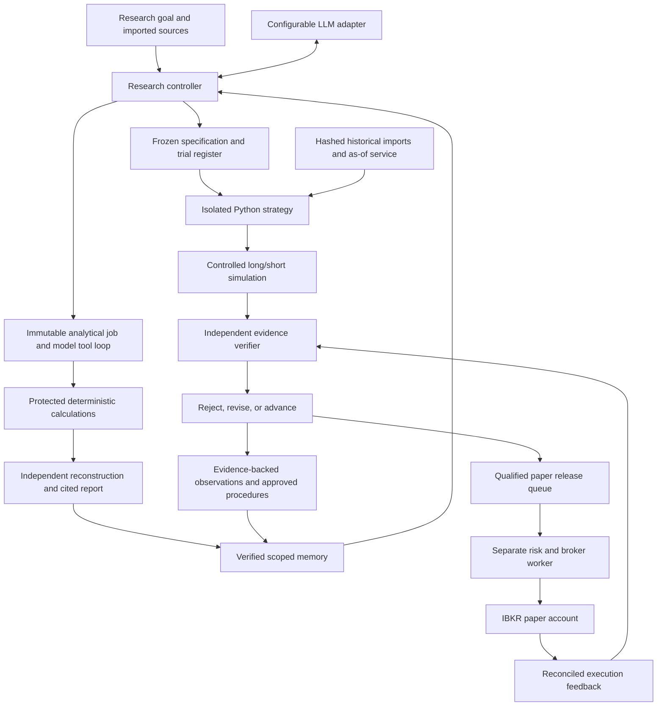
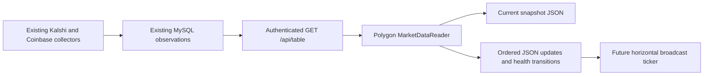

# Research agent with verified memory — V1 contract

This document expands the selected architecture and records its implementation boundary. Status and acceptance evidence live in PROGRESS.md and AGENT_ACCEPTANCE.md. It does not replace the original frozen economic research specification.



## Trust and learning boundaries

The model controls research proposals and Python strategies. Host code controls workflow transitions, data qualification, evidence integrity, graders, spend, decision criteria, risk and broker access. Generated code runs only inside Docker and receives a single dated context at a time. Imported papers, model messages, logs and memory are evidence; their instructions cannot override those controls.

The learning loop is propose -> preregister -> implement -> run fixed controls -> independently challenge -> decide -> verify lesson -> retrieve on subsequent tasks. A negative economic result is retained. A failed experiment contributes error facts with `metrics_trusted=false`; it cannot contribute profit assertions. Verified memory observations are derived from exact JSON pointers, avoiding unsupported summaries. Procedures currently come from eight approved methodological templates; authoring/promoting new executable procedures is a later development stage.

Foundation-model weights remain fixed. V1 self-improvement means better performance on unfamiliar reserved tasks under the same model and comparable budgets. Financial performance, researcher competence and execution reliability have separate gates.

## Provider-neutral interfaces

| Interface | Contract |
|---|---|
| Model | `generate(ModelRequest) -> ModelResponse(content, input_tokens, output_tokens, metadata)` |
| BTC market data | `MarketDataReader.snapshot() -> dict`; `iter_updates(iterations=0) -> Iterator[dict]`; original platform fields, explicit timestamps/health and stable source-row identities |
| Research specification | Hypothesis; exact dataset; preselected risky baseline; scored dates; lookback; decision timing; costs; uncertainty; rejection gates; source hashes; fixed limits |
| Strategy | `target_weights(context, state) -> {weights: {stable_id: weight}, state: JSON object}` |
| Evidence | Immutable JSON envelope `{kind,payload}` addressed by SHA-256; hash verified on every read |
| Memory | Exact observations; approved procedure; US/daily/qualification scope; uncertainty; evidence hash; explicit conflict/supersession |
| Paper release | Exact research/specification/strategy/qualification receipts, immutable limits and account allowlist |
| Order intent | Release/account/session/security/quantity/as-of/reason plus protected preflight; logical identity survives changing receipts |

Chat-completions-compatible and native Anthropic styles are implemented with standard-library HTTP. Provider parameters/prices live in configuration; secrets are supplied by named environment variables. New adapters do not change research contracts. Pricing/model configuration is pinned on resume. API reservations and token/decision counters persist before network requests; ambiguous billing remains charged against the cap.

The optional global `--model-env .env` reads only the configuration's named credential from the unified private file, without interpolation or shell execution. Grok uses the existing chat-completions adapter with a dated configurable model and recorded prices. A first-episode coordinator requires genuine JSON and workflow smoke receipts bound to the exact configuration digest. It preregisters a fixed reference candidate before performance; ordinary research/work commands remain available for model-proposed hypotheses and generated code.

Import `data_constraints` and `qualification_gaps` accompany model context, experiment results and reports. Explicit long-only or coverage constraints bind proposed specifications. The Alpaca exploratory adapter records original observations plus disclosed missing/disputed payment-date and availability assumptions; those policies never upgrade proxy quality. Its strict mode stops on unresolved source inputs. Qualified-import requirements below are unchanged.

The first task transfer filters retrieval to evidence from that episode before ranking, then checks exact proposal schema, supplied evidence references and a typed protected research specification. Only the distinct task's hypothesis and preset 20-session lookback differ from its supplied template; dataset, available dates, account limits, costs and rejection gates remain bound. JSON numeric representations are normalized after finite typed/value checks. Citation-only legacy proposals are retained as unaccepted evidence. Descriptive proposal text remains subject to review before implementation; it is not executable authority or a verified performance claim. This establishes reuse of scoped verified observations; it does not establish better research performance. The separate frozen benchmark measures improvement. The coordinator exposes paper readiness only after research, verified transfer, measured-learning acceptance and qualified strategy/data; broker preflight and session acceptance remain separate.

The database uses SQLite with WAL and transactions. General memory search uses FTS5 plus structured scope filters. The research controller now projects relevant approved methods, evidence identities and original scope into at most two records/1,500 bytes; numeric findings remain in their source artifacts. It rechecks exact facts and requires explicit procedure overlap rather than a generic retrieval fallback. The prior 4,000-byte retrieval module and frozen historical evaluation snapshots remain available as separate preserved contracts. No embedding model or provider-specific memory service is needed. One research worker and one broker worker share protected state, rather than independently opening broker connections.

October 11 adds a bounded consolidation step after a finished independently challenged episode. The model selects three to six distinct approved procedures and exact paths from a supplied scalar catalog using short source handles. The host copies all values, validates every finding before any memory write, and retains the proposal and immutable reply receipts. One repair is permitted; failure saves no findings. A validated pending proposal resumes without a fresh model call, and completed consolidation is idempotent. The genuine first consolidation saved five findings and 17 exact observations from the rejected proxy study; this strengthens memory coverage without inventing profitable strategies or promoting data quality.

The replacement learning protocol freezes new task scenarios, explicit output schemas/units/enums, the system instruction, source hashes, exact model/pricing configuration and all contexts before calls. All three conditions receive the same task rules. Verified context is selected by task relevance; the raw comparator uses unranked chunks of the same past research artifacts and events, with the same byte cap. The host's answer keys never enter model messages. A full 40-task/three-condition/two-repetition campaign retains the original strict grader and improvement/hard-error thresholds. Semantic diagnostics cannot override acceptance. The original campaign is retired and preserved; absolute scores across the two protocol versions are not a learning comparison. The original first-episode learning control is not overwritten by the replacement result.

## Existing BTC infrastructure connection



The reader lives in the merged Polygon package and uses standard-library HTTP; it does not import the infrastructure's pandas client or trading engine. It reads only `forward_quotes` for KXBTC15M and `coinbase_ticks` for BTC-USD. Configuration is `{base_url:HTTPS_SERVICE_URL}`; named dashboard credentials come from the environment or the existing literal env-file loader. The model loader remains a one-key wrapper over that shared parser. Constructing a reader performs no network access, and feed CLI commands return before research-store construction.

Each poll fixes a three-minute UTC window before paging, using the existing inclusive `/api/table` contract. Window/response bounds prevent an invalid service from creating unbounded reads. Snapshot chooses the newest collected batch; update iteration orders each batch by collection time and source row ID, deduplicates the overlap and emits health transitions without replaying an unchanged row. IDs include the source, preventing collisions across the two tables. Contract tickers remain distinct through rotation. A restart starts a new catch-up; longer outages require a future durable replay mechanism.

Native decimal strings and original table field names are retained. Infrastructure timezone-less collection timestamps have the repository's documented UTC meaning. Kalshi source time uses `ts_ms`, then `ts`, then an aware `time`; see the [official ticker contract](https://docs.kalshi.com/websockets/market-ticker). Coinbase ticker `time` dates the last trade and is exposed as `last_trade_time_utc`, separately from collection time; see the [official ticker contract](https://docs.cdp.coinbase.com/api-reference/exchange-api/rest-api/products/get-product-ticker). REST observations without a source timestamp expose null source time and collection-only freshness. Source/event time is not asserted as historical availability evidence.

Collection age over 60 seconds is stale, with an independent 60-second Kalshi source-age check. Collector failures, missing quotes, nonfinite/out-of-range/crossed values and malformed/future timestamps cannot appear as healthy current data. Transient transport/service errors become independent feed-health records; authentication/configuration failures stop. Credentials, raw error bodies and raw source documents are excluded from output, redirects are refused, and remote URLs require HTTPS.

This is an unqualified observation interface. It is not connected to generated strategy contexts, protected analytical jobs, qualification, memory, paper releases or trading execution. Financial and learning gates retain their existing evidence and results. The future UI consumes `market_data` and `feed_health` records as a horizontal broadcast feed. Canonical handoff (local archive: `../results/market_data_integration_2026-10-13/HANDOFF.md`) records verification and remaining live-access gates.

## Protected analytical task loop

`analysis_tools.py` supplies eight allowlisted operations: as-of selection, holding-period returns, signed corporate-action accounting, assumption comparison, cost attribution, exposure/free-cash summaries, fixed research gates and fill reconciliation. This is trusted host code with no file/network/broker access; it never executes generated Python. Generated strategy isolation remains a separate Docker boundary. Decimal calculations are independently reconstructed with Fraction arithmetic. Return calculation accepts only history produced by the as-of tool, checking both effective and available timestamps before use. A source document cannot supply that derived input kind.

`task_agent.py` accepts bounded immutable jobs, then asks any configured Model adapter to choose one JSON action at a time. Public schemas enumerate current input handles and valid receipt pointers. The calculate/report phase and verified receipt summaries are shared with the model; no expected answer key or prior numerical answer is supplied. A final report must cite each requested field from a verified receipt, and host code copies those values. Four model calls and one repair are allowed. Counters persist before requests, duplicate tool receipts are idempotent, failed sessions keep their exhausted allowance, and completed sessions return stored results without a model call. The job, dependencies, actions, safe rejection reasons, final report and source quality are retained.

`procedural_memory.py` verifies the entire dependency chain before recording exact tool-name/input-kind facts under an existing approved methodology. Retrieval requires the same task family and initial input kinds; at most two procedures/1,500 bytes include their evidence and original synthetic/proxy scope. Historical values and training handles are excluded. A transferred synthetic procedure remains synthetic evidence when applied to a proxy job; new evidence receives the current job's actual scope. No executable-method promotion or model-weight training occurs.

`research-task prepare/run/status` exposes this analytical component. The research controller's optional `analyze` action requires a job bound to its dataset identity and quality, and leaves workflow state and protected economic policy unchanged. Descriptive five-session calculations do not constitute a strategy study, licensed-source qualification or order permission. `tool-study` separately declares practice before calls, saves only verified completed procedures, freezes disjoint workflow evaluation cases and compares no context, raw traces and selected procedures with identical tools and call/schema bounds. Fixed improvement gates remain authoritative, including when an effective tool baseline leaves little room for a memory gain.

## Historical import schema

`manifest.json` declares `schema_version:1`, quality (`synthetic`, `proxy`, or `licensed_unqualified`), source metadata, and `files` entries for all tables: `{path:"table.csv",sha256:"..."}`. Imports cannot self-declare qualified. Paths resolve inside the import directory. Rows must use ISO session dates and timezone-aware availability/open/close timestamps.

| CSV table | Exact columns |
|---|---|
| sessions | session, open_at, close_at, settlement_date |
| assets | asset_id, symbol, kind, currency, leverage_factor, inverse |
| bars | session, asset_id, open, high, low, close, volume, available_at |
| membership | session, asset_id, eligible, available_at |
| actions | session, asset_id, kind, value, pay_date, available_at |
| borrow | session, asset_id, shares, fee_rate, available_at |
| financing | session, credit_rate, debit_rate, reference_rate, available_at |

Eligibility (`0`/`1`) is explicit for each security/session, including prelisting/postdelisting periods. Securities use stable IDs; historical ticker revisions are resolved by the import provider, and broker contract mappings are reviewed separately. Allowed types: USD common stocks and unleveraged, noninverse ETFs (`leverage_factor=1`, `inverse=0`). Shorts are common stocks only. Prices are raw positive OHLC; volume may be zero but cannot be negative. Unsupported actions, duplicate keys/vintages and missing eligible bars fail rather than being silently removed/imputed.

Supported actions: `split` (positive ratio), `dividend` (amount per post-split share and actual pay_date), `delist_cash` (qualified payout, possibly zero). Fractional split/cash-in-lieu, mergers/spinoffs and other unresolved actions block affected experiments. Consolidate equivalent same-date events only when economic/payment timing is preserved. Each session has its actual reviewed settlement date; the synthetic fixture's weekday calendar is explicitly artificial.

The frozen decision cutoff defaults to 30 minutes after the prior close, supports 0–120 minutes, and must precede execution. A completed daily bar cannot be stamped before its close. Histories exclude records whose actual availability exceeds the cutoff. Retrieval timestamps/current-vintage reconstructions are not substitutes for original availability evidence. Mature historical returns may be used inside the prefix; no future labels/dataset files are exposed.

Qualification additionally requires manifest declarations `availability_basis:historical_asof`, `corporate_action_coverage:complete`, `universe_coverage:survivorship_free`, `borrow_basis:historical`, complete explicit eligible-stock borrow/fee coverage, and an independent documented review. The review checks: rights; independent source; actual availability/vintages; universe/survivorship; actions/pay dates; settlement calendar; historical borrow/financing.

Attestation shape:

```json
{
  "dataset_id": "EXACT_MANIFEST_HASH",
  "reviewer": "NAMED_OPERATOR_OR_DATA_REVIEWER",
  "checks": {
    "rights": {"passed": true, "notes": "Evidence and permitted use"},
    "independent_source": {"passed": true, "notes": "Independent corroboration"},
    "availability_vintages": {"passed": true, "notes": "Original availability evidence"},
    "universe_survivorship": {"passed": true, "notes": "Listings/delistings included"},
    "corporate_actions_pay_dates": {"passed": true, "notes": "Issuer event/payment evidence"},
    "settlement_calendar": {"passed": true, "notes": "Historical settlement rules/calendar"},
    "historical_borrow_financing": {"passed": true, "notes": "Dated availability/fees/rates"}
  },
  "document_paths": {
    "rights": "rights.txt",
    "independent_source": "source.txt",
    "availability_vintages": "availability.txt",
    "universe_survivorship": "universe.txt",
    "corporate_actions_pay_dates": "actions.txt",
    "settlement_calendar": "settlement.txt",
    "historical_borrow_financing": "borrow.txt"
  }
}
```

Supporting files are preserved as hashed UTF-8 evidence. These are operator-reviewed claims, not an automated guarantee that a provider's licensing or history is correct. The research model has no qualification tool.

Paper manifests add `next_session:{session,previous_session,open_at}` backed by the reviewed exchange calendar. Current inputs must reach that previous completed session. Fresh snapshot qualification is distinct from a strategy's historical qualification.

## Accounting, controls and decisions

Capital enters at the first scored session; warmup does not earn fictitious cash income. Integer quantities are selected from prior prices/volumes before next-open raw fills. Sells are recorded as unsettled credits. Short proceeds are restricted; conservative collateral is 150% of marked short value and negative dividend claims reduce available funds. Borrow fees use known annual fractions/calendar holding days; cash interest uses declared rates on free cash. Borrow recalls force covers even inside the buffer. Unsupported actions/insolvency stop the run.

V1 intentionally uses conservative cash/accounting rules and simple reference baselines. It preserves the older ETF simulator and its six regression tests; it does not assert numerical parity with that simulator's different cash/dividend/settlement/feature assumptions. Adoption of the old economic hypothesis needs a separately declared compatibility study.

Each experiment registers six trials before execution: baseline/candidate at normal, doubled, and zero modeled transaction-and-borrow costs. Raw adjusted-close data is excluded from execution. The independent verifier reconstructs cash, shares, raw marks, splits, dividend claims/payments, settlement, interest/borrow fees, fills and NAV without importing the simulator/planner. Money tolerances are max($0.01, 1e-8 NAV); dimensionless returns/exposures have separate strict tolerances.

Challenges compare a restarted prefix with the full run and perturb future bars, dividends, volume and fees. Statistics include excess Sharpe, drawdown, notional turnover separately from orders, matched cost attribution, annual gains, gross exposure, benchmark beta and paired circular block bootstrap. Broader factor/sector datasets and capacity calibration remain extensions. Historical selection and repeated experimentation are disclosed; statistical pass never implies confirmed/live alpha.

Default advance gates: Sharpe gain >=0.10 over the frozen risky comparator; positive one-sided 95% paired lower bound; at least two declared blocks; drawdown deterioration <=2 percentage points; positive gain with doubled transaction and borrow costs; verified accounting/causality; qualified data. An unqualified practical pass revises data qualification; a practical failure rejects. New hypotheses/parameters require new specifications and all attempts remain visible.

The model cannot relax the operator-controlled mandate or cost policy. Paper promotion independently enforces block length >=21 sessions and >=2,000 bootstrap samples plus the minimum practical thresholds; cheaper exploratory uncertainty estimates cannot bypass it.

## Paper and operational feedback

An eligible release is queued without letting the model call the broker. The broker worker verifies the exact DU account, SDK/version, contract IDs, complete/fresh account/position/order/execution snapshots, qualified current inputs, current realtime borrow and fees, margin and settled cash. Orders use `MKT`/`OPG` before the reviewed open; paper simulation is not proof of real auction execution.

The whole session batch and strategy checkpoint are fixed before the first submit. Persistent intents progress planned -> sending -> acknowledged/unknown -> filled/cancelled/rejected. A reference field correlates orders, but does not guarantee broker-side idempotency. Unknown acknowledgement pauses; reconciliation precedes retry decisions. Duplicate execution IDs do not duplicate fills. Corrections, excess fills, inconsistent positions, stale inputs and cash/risk failures remain visible and stop new trading. Risk history survives strategy transitions; protective pause cancels owned pending orders without automatic liquidation.

Recovery waits for prior sends to become terminal before submitting remaining orders, then rechecks aggregate settled cash, margin and borrow. Position reconciliation applies corporate actions only after their effective session. An operator-only one-share control can test paper infrastructure when economic research rejects its candidates; it still requires data qualification and risk checks, carries no alpha claim, and is unavailable to the model.

Execution/position evidence and statement-based attribution are implemented. `paper record-close` captures a post-close API snapshot; `paper-audit` independently matches an operator-normalized statement to that snapshot and the execution journal. It preserves a hash of the original broker export, checks cash continuity, trades, fees, positions and qualified corporate actions, categorizes borrow/interest/tax activity, and rejects unexplained transfers. Its observations enter scoped operational memory with no alpha claim. V1 does not automatically rewrite deployed parameters from a fill discrepancy. A new investigation/specification is required to turn attributed feedback into a change. Actual statement/source authenticity and five-session evidence remain external acceptance gates.

Normalized statement contract: `account`, `currency:USD`, `session`, `complete_session:true`, `opening_cash`, `closing_cash`, `opening_positions`, `closing_positions`, and ordered `events`. Events have unique `event_id`, `kind`, finite `amount`, optional `currency:USD`, and the fields required by kind. `trade` uses `execution_id,asset_id,quantity,price`; `commission` uses `execution_id`; `split` uses `asset_id,ratio`; `delist_cash` uses `asset_id`; `dividend` uses `asset_id,ex_date`; `borrow_fee,interest,tax` are categorized cash entries. Events must preserve economic chronology (actions before same-day trades). Positive borrow/tax expenses, omitted fees/executions, duplicate activity, unsupported fractional actions and unexplained movements fail. The normalizer/operator remains responsible for mapping the actual broker export and its trade/settlement basis faithfully.

## Deferred work and release status

Actual container validation passed on October 10, 2026: 15 real probes against the locked Linux arm64 image, plus a scripted synthetic six-trial research episode through Docker. [Verification evidence](../results/docker_validation_2026-10-10/verification.json) records the exact runtime/image and the remaining gates. A new image/runtime/platform requires revalidation. Checkpoints preserve explicit finite JSON state; authors must serialize any required random-generator state for continuation.

Both genuine Grok smoke cases have passed. Three complete learning protocols failed: the latest protected-tool workflow scores 81.25% verified procedures, 83.75% no context and 80.00% raw traces, with 13 memory hard failures. All completed reports match independently reconstructed values; action/report completion remains a limitation. A transport-interrupted 139-episode campaign is retired separately, with uncertain billing charged and a narrowly scoped normalized-error fix independently tested. [Handoff](../results/tool_research_2026-10-11/HANDOFF.md) records the 122 offline tests, 39-check audit and zero-cost replay. Measured-learning acceptance, qualified licensed imports and paper-account/statement acceptance are still required before calling V1 accepted. [The licensed-data shortlist](../results/docker_validation_2026-10-10/data_candidates.json) distinguishes published coverage/rights from sample/contract questions; none is qualified yet. Hosted LLM processing, research-memory retention and customer outputs need explicit rights alongside prices/reference/actions, with separate historical borrow/financing evidence for shorts. Old-engine economic compatibility needs a separately frozen study if that hypothesis is adopted. Source acquisition automation, novel procedure promotion, broader factor/capacity studies, model-weight training, multitenant privacy/shared learning and cloud/UI/live-capital deployment are later architectures/extensions.
