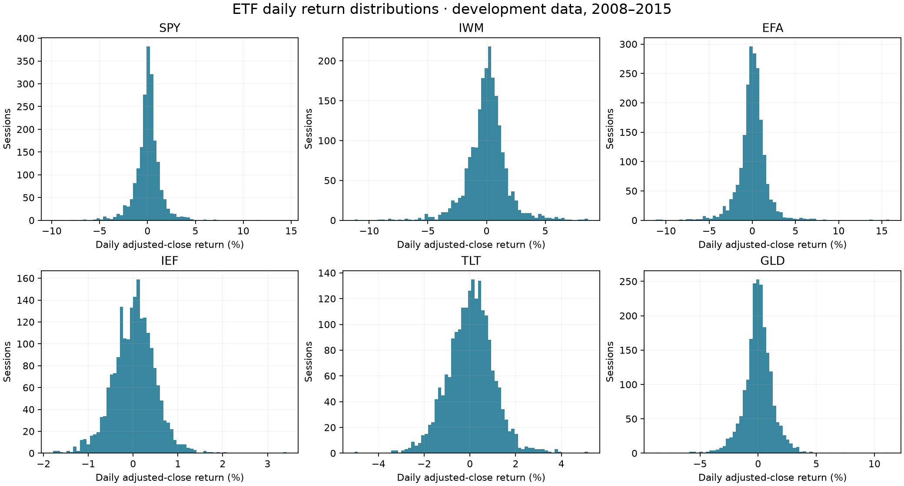
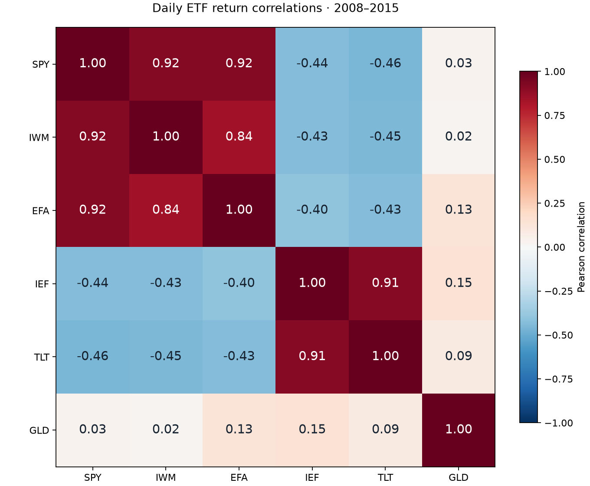
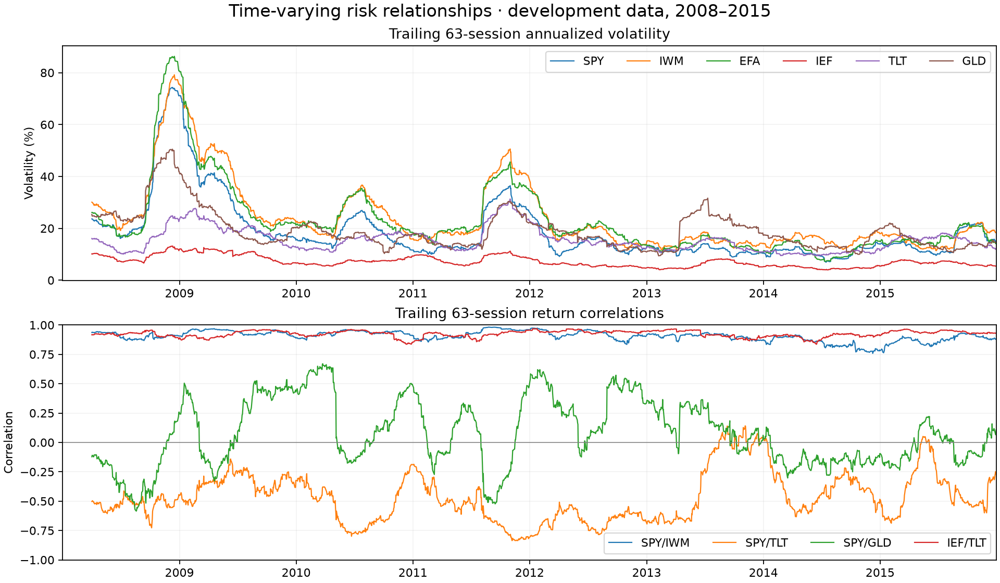

# Development-period ETF data exploration

Completed October 8, 2026 (Asia/Shanghai). The hypothesis and rejection rules were fixed before these checks. No strategy backtest or parameter search was performed.

Source: Yahoo Finance public daily chart snapshot. Requested bars: 2006–2015. Statistical summaries: 2008–2015 only. Validation and holdout observations from 2016 onward are excluded.

Calendar: 2,517 expected sessions; 2,015 development sessions; 23 half days. Ford and Sandy closures are handled explicitly.

## Missingness and structural checks

| ETF | Rows | Missing sessions | Missing cells | OHLC violations | Zero-volume days |
| --- | ---: | ---: | ---: | ---: | ---: |
| SPY | 2517 | 0 | 0 | 0 | 0 |
| IWM | 2517 | 0 | 0 | 0 | 0 |
| EFA | 2517 | 0 | 0 | 0 | 0 |
| IEF | 2517 | 0 | 0 | 0 | 0 |
| TLT | 2517 | 0 | 0 | 0 | 0 |
| GLD | 2517 | 0 | 0 | 0 | 0 |

No forward filling, winsorization, or deletion of flagged market extremes was applied.

## Return distributions

| ETF | Annualized volatility | 1st percentile daily return | 99th percentile daily return | Skewness | Excess kurtosis |
| --- | ---: | ---: | ---: | ---: | ---: |
| SPY | 22.14% | -4.39% | 3.86% | 0.25 | 13.62 |
| IWM | 27.23% | -5.06% | 5.00% | -0.19 | 4.91 |
| EFA | 26.60% | -5.25% | 4.88% | 0.28 | 10.93 |
| IEF | 7.49% | -1.16% | 1.17% | 0.10 | 2.03 |
| TLT | 15.97% | -2.44% | 2.68% | 0.04 | 1.21 |
| GLD | 20.36% | -3.58% | 3.14% | -0.06 | 6.54 |

These are distributions of individual ETF adjusted-close returns, not strategy returns. Tail flags are review candidates, not proof of bad data.

SPY excess kurtosis is 13.62; EFA is 10.93. This development sample has substantial tails and is not well described by a fixed Gaussian return model. No extreme-value cleaning is justified by distribution shape alone.

## Outliers and volume checks

The prespecified checks flagged 34 asset/session observations. All remain in the evidence. Examples include SPY +14.52% on 2008-10-13, IWM -11.24% on 2008-12-01, and GLD -8.78% on 2013-04-15. These large moves require independent corroboration before formal evidence qualification.

IEF has 14 observations above ten times its preceding 20-session median volume. These flags could reflect actual trading or data problems; this single-source snapshot cannot decide between them. Median shares traded per session and return/relative-volume relationships are in volume_relationships.csv.

## Relationships

| ETF | SPY | IWM | EFA | IEF | TLT | GLD |
| --- | --- | --- | --- | --- | --- | --- |
| SPY | 1.00 | 0.92 | 0.92 | -0.44 | -0.46 | 0.03 |
| IWM | 0.92 | 1.00 | 0.84 | -0.43 | -0.45 | 0.02 |
| EFA | 0.92 | 0.84 | 1.00 | -0.40 | -0.43 | 0.13 |
| IEF | -0.44 | -0.43 | -0.40 | 1.00 | 0.91 | 0.15 |
| TLT | -0.46 | -0.45 | -0.43 | 0.91 | 1.00 | 0.09 |
| GLD | 0.03 | 0.02 | 0.13 | 0.15 | 0.09 | 1.00 |

SPY/IWM correlation is 0.92, SPY/EFA is 0.92, and IEF/TLT is 0.91. Multiple ETF tickers do not imply independent exposures. SPY/TLT is -0.46 and SPY/GLD is 0.03 over this sample, but their rolling correlations vary materially.

Same-session relationships are descriptive. Annual and rolling correlations, Spearman correlations, sample counts, within-asset lags, and volume relationships are exported separately. They do not establish predictive ability.

## Timing and adjustments

Daily timestamps are converted to America/New_York before assigning session dates. A bar labelled 09:30 represents a full daily bar; it was not available at 09:30. Features based on its close require completed-session data and a later eligible execution session.

Yahoo adjusted close incorporates splits and dividends. Event/adjustment checks are descriptive reconciliation against the same provider, not an independent validation. The raw response can contain dynamic current quote metadata; that metadata is excluded from all analysis.

Across dividend-paying ETFs, adjustment-factor changes reconcile with the reported distributions to a maximum difference of 0.0149 basis points. No significant factor changes lack a reported dividend. Closing-price and adjusted-close daily returns differ by up to 2.50 percentage points for EFA, showing why dividend handling matters. This does not verify dividend payment dates or historical adjustment vintages.

## Qualification decision

Structural checks pass: True. The snapshot is suitable for this descriptive exploration only. The original formal-data requirements remain outstanding: point-in-time revisions, qualified raw execution prices, dividend payment dates, historical release timing, independent source checks, and applicable data rights.

No hypothesis, window, threshold, universe, cost assumption, or rejection criterion was changed after exploration.

Sources: [Yahoo adjusted-close definition](https://in.help.yahoo.com/kb/adjusted-close-sln28256.html); [exchange_calendars](https://github.com/gerrymanoim/exchange_calendars); [NYSE trading calendar](https://www.nyse.com/trade/hours-calendars); [Nasdaq Sandy closure notice](https://www.nasdaqtrader.com/TraderNews.aspx?id=ETA2012-44).

Detailed evidence: eda_summary.json, flagged_observations.csv, largest_moves.csv, return_distributions.csv, correlation_*.csv, annual_correlations.csv, rolling_correlation_summary.csv, lagged_correlations.csv, volume_relationships.csv, expected_sessions.csv, and ../data/manifest.json.
