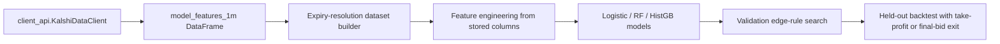

# Expiry-Resolution Multi-Minute Model Research

## Thesis

Instead of predicting the next minute move, this research predicts whether the active 15-minute BTC contract will finish in a YES-like terminal state.
Entries only fire when model probability clears both a minimum probability threshold and a binary-contract edge threshold `p_yes - yes_ask_dollars`.
Once in a trade, the exit logic is simple: take profit when the bid reaches `entry ask + 5c`, otherwise hold to the final bid observed for that ticker.

## Signal Flow



## Dataset

- Rows: 5909
- Time range: 2026-03-07 02:11:00 to 2026-03-11 20:06:00
- Positive rate: 0.4793
- Split: train=3545, validation=1182, test=1182

## Held-Out Results

| Model | Test PnL | Trades | Win Rate | Avg PnL | AP | AUC | Validation Rule |
| --- | ---: | ---: | ---: | ---: | ---: | ---: | --- |
| Random Forest Resolution Edge | 0.16 | 9 | 0.8889 | 0.0178 | 0.8483 | 0.8468 | p>=0.65, edge>=0.08 |
| HistGradientBoosting Resolution Edge | 0.15 | 131 | 0.8321 | 0.0011 | 0.8137 | 0.8095 | p>=0.55, edge>=0.08 |
| Logistic Resolution Edge (Benchmark) | 0.11 | 1 | 1.0000 | 0.1100 | 0.8540 | 0.8501 | p>=0.80, edge>=0.08 |

## Recommendation

The corrected backtest does not support live deployment yet.
The random forest is closest to viable under conservative exits and currently carries the stronger held-out ranking metrics of the two new tree candidates.
The HistGradientBoosting model is still useful as the broader, more active tree baseline, but it is not robust enough yet to justify production use.
Those models are worth keeping in the work folder as research candidates because they are clearly stronger ranking models than the old one-minute setup, but they still need either:

- more history than the current ~4 day sample,
- a better execution policy than fixed take-profit-or-final-bid, or
- richer features than the current `model_features_1m` snapshot alone.

## How To Re-Run

```bash
python work/run_horizon_model_research.py
```
